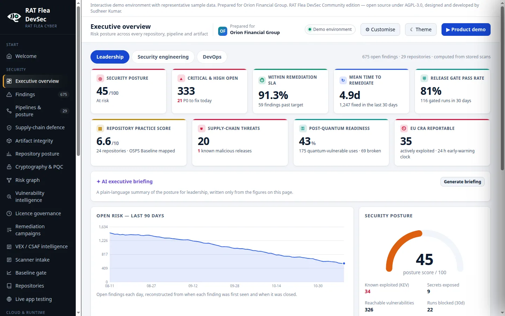

# NERvvE DevSecOps — Community edition

**Secure the code, the pipeline that builds it, and the artifact that ships.**

> Free and open source under the [GNU AGPL-3.0](LICENSE). © 2026 Sudheer Kumar.
> NERvvE DevSecOps Product designed and developed by Sudheer Kumar.

NERvvE DevSecOps is a DevSecOps and cloud-native application protection platform. Fifteen engines from code to cloud
to runtime write into one finding schema, one exploitability-based risk score (the NERvvE Risk Score) and one policy,
enforced from the developer's laptop through the pull request and pipeline gate to Kubernetes admission.

📖 **Documentation:** <https://sudheerkumard.github.io/nervve-devsecops/>



## What it covers

| Engine | What it covers |
|---|---|
| SCA + reachability | Open-source dependencies (npm, PyPI, Maven, Go) with import-graph reachability |
| SAST | First-party code: injection, deserialisation, TLS, JWT, crypto |
| Secrets | Code, history and pipeline definitions, with high-confidence and live-credential flags |
| IaC | Terraform, Bicep/ARM, Kubernetes, Helm, Dockerfile |
| Container | Image OS and language packages (Trivy) |
| **Pipeline posture** | GitHub Actions, GitLab CI, Azure Pipelines, Jenkins, Bitbucket, mapped to the OWASP Top 10 CI/CD risks |
| Licences | Copyleft and deny-list policy |
| DAST / API | Running web apps and APIs: read-only checks, crawler, multi-user authorisation tests, authorised active checks |
| **AI-BOM** | Models, prompts, agents and MCP tools (OWASP LLM Top 10) |
| **Provenance** | Sigstore signing, SLSA provenance, SBOM attestation, admission verification |
| **Cloud posture (CSPM)** | Azure, AWS and Google Cloud configuration against the CIS foundations benchmarks |
| **Kubernetes posture (KSPM)** | Pod Security Standards, RBAC, exposure, network isolation, node versions |
| **Identities (CIEM)** | Effective privilege across Azure, AWS, Google Cloud and Kubernetes |
| **Runtime (CWPP)** | Falco and Tetragon detections grouped per workload and mapped to MITRE ATT&CK |
| **Attack paths** | Internet exposure + exploitable weakness + privileged identity or data store, linked back to the repository |

Around the engines: a web console, VEX and CSAF triage, AutoFix pull requests, policy as code (YAML or OPA/Rego),
compliance mapping (OWASP, PCI DSS, ISO 27001, NIST SSDF, SOC 2, EU CRA), ticketing, a pre-commit hook, an MCP server
for AI coding assistants, and an offline AI assistant.

## Quick start (demo in 60 seconds)

```bash
git clone https://github.com/sudheerkumard/nervve-devsecops.git && cd nervve-devsecops

./demo/start-demo.sh                 # macOS / Linux  → http://localhost:8080   (Windows: demo\start-demo.ps1)
docker compose up --build            # or Docker       → http://localhost:8080
open demo/offline/NERvvE-DevSecOps-Demo-Console.html   # or no server: embedded demo snapshot
```

With the API running, **Live scan** runs the real engine against `demo/vulnerable-app`. The demo tenant
"Orion Financial Group" is fictional; its findings use real public CVEs.

## Scan your own code (CLI and pipeline gate)

```bash
pip install .                          # provides the `myelin` command (Python 3.10+)
myelin scan . --sarif out.sarif --sbom sbom.cdx.json --json out.json
echo $?                                # 0 pass · 1 blocked by policy · 2 error
myelin scan . --policy policies/myelin-policy.yaml --fail-on block
myelin scan --image myregistry/app@sha256:…          # needs trivy (bundled in Dockerfile.cli)
myelin dast --target https://api.example.com --openapi spec.json   # only APIs you are authorised to test
myelin attest --image myregistry/app@sha256:… --sbom sbom.cdx.json   # cosign keyless sign + SBOM attestation
```

The platform and CLI images bundle Opengrep (with NERvvE's own data-flow rule pack), Trivy, Gitleaks, Checkov and Bandit,
and run them alongside the built-in engines, normalising their output and removing duplicates. Each scan records which
areas it actually examined; reports list only those (see docs/concepts/scanning.md). Ready-made pipeline templates are in [`ci-templates/`](ci-templates/).

Apply supplier VEX or CSAF statements to a saved scan. An exact vulnerability ID and package URL are required, and
imported `not_affected` evidence stays visible and never closes a finding by itself:

```bash
myelin vex --results out.json --document supplier-vex.json --output assessed.json
myelin gate --results assessed.json
```

## Run the platform

```bash
# Single host: PostgreSQL + Keycloak (MFA) + migrations + API + TLS
scripts/ops/gen-secrets.sh > config/backend/enterprise.env
docker compose -f docker-compose.enterprise.yml --env-file config/backend/enterprise.env up -d

# Windows laptop (Docker Desktop): one script; add organisations with scripts\windows\new-tenant.ps1
powershell -ExecutionPolicy Bypass -File scripts\windows\start-enterprise.ps1     # guide: docs/ENTERPRISE-WINDOWS.md

# Kubernetes
helm upgrade --install myelin deploy/helm/myelin -f config/deploy/values-customer.example.yaml
```

**First installation?** Read [First-time setup and common issues](docs/getting-started/first-time-setup.md): corporate
networks that inspect HTTPS, creating organisations and linking users.

OIDC sign-in (Keycloak, Entra ID, Okta, Auth0, Ping, Google), MFA with step-up, six-role RBAC, PostgreSQL row-level
security for multi-tenancy, read-only cloud connectors and a hash-chained audit log are all included. No licence key is
needed. See [identity](docs/enterprise/IDENTITY.md), [multi-tenancy](docs/enterprise/MULTI-TENANCY.md),
[connectors](docs/enterprise/CONNECTORS.md) and [operations](docs/enterprise/OPERATIONS.md).

## Repository layout

```
engine/myelin_engine/   scan engine and the `myelin` CLI (orchestrator, scoring, policy, engines, normalisers)
backend/app/           FastAPI API: findings, pipelines, supply chain, compliance, policy, connectors, scans
console/               single-page console (console.template.html → index.html via scripts/build_console.py)
ci-templates/          GitHub Actions, GitLab CI, Azure Pipelines, Jenkinsfile, Bitbucket, CD templates
policies/              myelin-policy.yaml and its OPA/Rego equivalent
deploy/                Helm chart, Keycloak, Compose and Kubernetes manifests
config/                every setting, with examples (see config/README.md)
demo/                  start/stop scripts, offline console and an intentionally vulnerable repository
docs/                  documentation site sources (mkdocs.yml; build with scripts/build_docs.py)
```

Code identifiers (the `myelin` command, `myelin_engine`, `MYELIN_*` settings) keep their original names so existing
pipelines and configuration keep working.

## Tests

```bash
pip install -r backend/requirements.txt -r backend/requirements-dev.txt
python -m pytest -q backend/tests engine/tests          # PostgreSQL tests skip without a database
MYELIN_TEST_PG="host=localhost port=5432 user=postgres password=..." python -m pytest -q backend/tests engine/tests
```

## Contributing

Contributions are welcome. Read [CONTRIBUTING.md](CONTRIBUTING.md) and the [Code of Conduct](CODE_OF_CONDUCT.md);
pull requests need the [Contributor Licence Agreement](CLA.md). Report vulnerabilities privately as described in
[SECURITY.md](SECURITY.md).

## Licence

NERvvE DevSecOps Community edition is licensed under the GNU Affero General Public License v3.0 only
([LICENSE](LICENSE)). If you run a modified version as a network service, the AGPL requires you to offer its source
to the users of that service. Commercial licences (for use without AGPL obligations), support and customisation are
available from the author through <https://github.com/sudheerkumard/nervve-devsecops>. Third-party components are
listed in [THIRD-PARTY-NOTICES.md](THIRD-PARTY-NOTICES.md); see [NOTICE.md](NOTICE.md) for names and trademarks.
