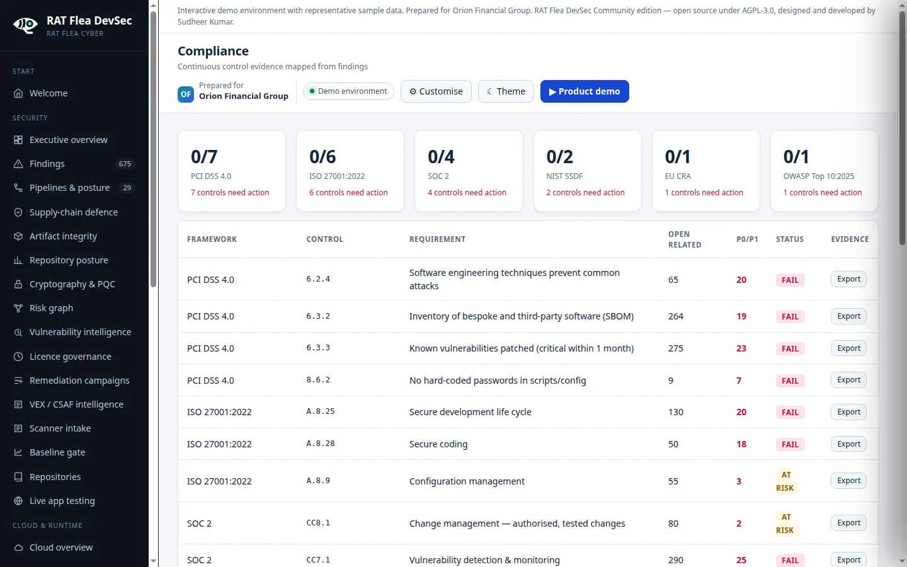

# Corporate assessment reports

{ .nm-shot }

Every repository scan and every live-app run produces a corporate assessment report. It is a single self-contained document that prints to a paginated A4 PDF from any browser.

To get a report, go to Console → **Repositories** (or **Live app testing**) → **Full report**, then choose:

| Option | Effect |
|---|---|
| **Edition: Internal** | Includes code evidence, line numbers and secret locations. For your own teams. |
| **Edition: External** | Withholds code evidence, line numbers and secret locations, and is worded for an outside reader. Use it to publish to *your* customers. |
| **Prepared for** | Your customer's name on the cover and in document control. |
| **Report title / Classification** | Printed on the cover and in every page footer. |

Click **Open report**, then **Download PDF / print** to save a PDF. **Download HTML** keeps the original file.

## Contents

1. **Cover**: NERVE Myelin — DevSecOps branding, customer name before the repository name, overall risk rating, prepared for, prepared by NERVE Myelin, date, report reference, target and snapshot.
2. **Document control** and table of contents.
3. **Executive summary** (dashboard page):
   - risk rating and key messages
   - KPI cards (open findings, critical & high, CVEs, control gaps) and a severity-mix bar
   - open findings by area stacked by severity, and the risk-score distribution
   - a control coverage heat map for every framework
4. **Assessment scope**: target, snapshot or commit, components, which areas were assessed.
5. **Top risks**: the ten findings with the highest risk score.
6. **Risk by area**: severity × area matrix.
7. **Framework & compliance alignment**: per framework and control, a status of **Gap**, **Observation**, **No issues found** or **Not assessed**, with the open findings by severity.
8. **Remediation roadmap**: P0–P3 targets (2/7/30/90 days) and the dependency upgrades that close the most vulnerabilities.
9. **Vulnerability register (CVE)** (code reports): every CVE or advisory with a link to its public record (NVD, GitHub Advisory Database or OSV), package, installed and fixed versions, CVSS, EPSS, KEV and reachability.
10. **Detailed findings**: each finding with priority, risk score, rule, location, CWE/CVE/CVSS/EPSS/KEV, remediation and framework references.
11. **Software bill of materials** (code reports): licences, ecosystems and dependency type charts, and the component list.
12. **Methodology**, **definitions** and **attestation & disclaimer**, with a statement that the findings are released for review by the responsible DevOps and engineering team.

## Frameworks

| Framework | Version | Mapped from |
|---|---|---|
| OWASP Top 10 | 2021 | CWE of each finding; area for dependency, IaC, secrets and pipeline findings |
| OWASP API Security Top 10 | 2023 | Live-app tests |
| OWASP Top 10 CI/CD Security Risks | 2022 | Pipeline and deployment rules |
| CWE Top 25 Most Dangerous Software Weaknesses | 2024 | CWE |
| PCI DSS | v4.0 | 2.2, 6.2.4, 6.3.2, 6.3.3, 6.5.1, 8.6.2 |
| ISO/IEC 27001:2022 | Annex A | 5.17, 5.32, 8.8, 8.9, 8.25, 8.28, 8.32 |
| NIST SSDF | SP 800-218 v1.1 | PO.3, PS.1, PS.3, PW.4, PW.7, PW.9, RV.1 |
| NIST SP 800-53 | Rev. 5 | CM-6, CM-7, IA-5, RA-5, SA-11, SI-2, SR-3 |
| SOC 2 Trust Services Criteria | 2017 (rev. 2022) | CC6.1, CC7.1, CC8.1, CC9.2 |
| CIS Benchmarks | Docker / Kubernetes | Docker §4 and §5, Kubernetes §5.2 |

A finding is mapped to a control only when the control's own wording covers that kind of weakness. A framework that nothing in scope tests is left out of the report.

The report states that automated evidence *supports* but does not *establish* compliance. Process, people and physical controls are outside its scope.
