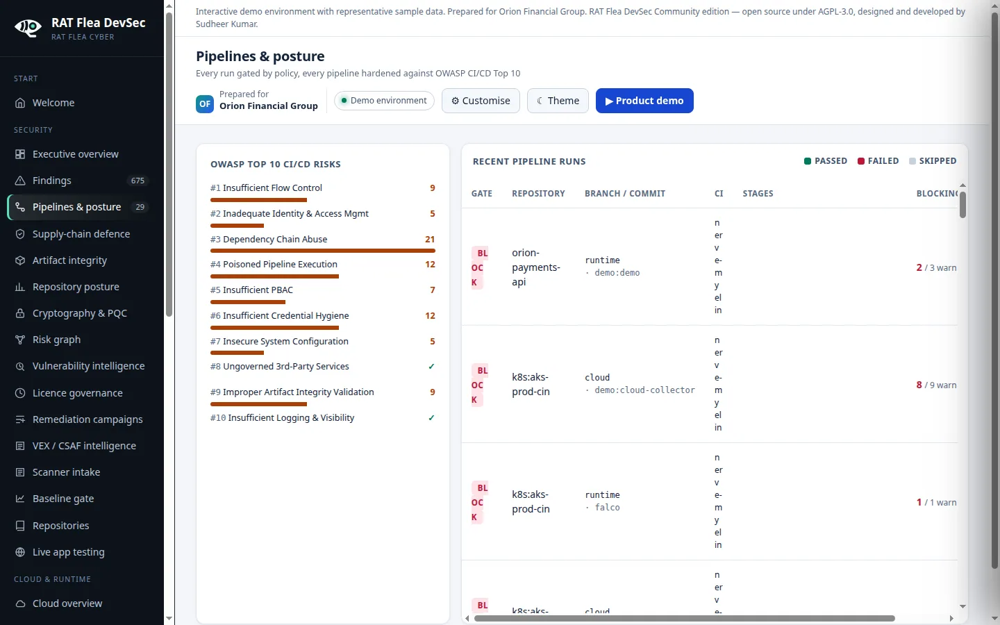

# Continuous delivery (CD) security

{ .nm-shot }

NERVE Myelin covers both halves of the pipeline:

- **CI** checks how code is built.
- **CD** checks how it reaches production:
  - deployment workflows
  - GitOps controllers
  - Helm/Kustomize values
  - cloud build definitions
  - the release gate itself

It needs no extra setup. Every repository scan, from the console or `myelin scan`, runs the CD checks with the CI/CD engine. They are reported under **CI/CD pipeline & deployment**.

## What is checked

| Rule | Finding | OWASP CI/CD |
|---|---|---|
| NM-CD-001 | Argo CD `AppProject` allows any source repository, any destination, or cluster-wide resources | CICD-SEC-1 |
| NM-CD-002 | GitOps application auto-syncs a moving branch (e.g. `main`/`HEAD`) | CICD-SEC-4 |
| NM-CD-003 | GitOps source fetched over plain HTTP | CICD-SEC-3 |
| NM-CD-004 | Flux `GitRepository`/`OCIRepository` without signature verification | CICD-SEC-9 |
| NM-CD-005 | Helm chart or release version not pinned | CICD-SEC-3 |
| NM-CD-006 | Deployment image tag is `latest` | CICD-SEC-3 |
| NM-CD-007 | Secret value written in deployment values or overlays | CICD-SEC-6 |
| NM-CD-008 | Production deployment job without an approval gate or protected environment | CICD-SEC-1 |
| NM-CD-009 | Deployment triggered by pull requests | CICD-SEC-4 |
| NM-CD-010 | `terraform apply -auto-approve` without a reviewed plan | CICD-SEC-1 |
| NM-CD-011 | Images deployed without signature or attestation verification | CICD-SEC-9 |
| NM-CD-012 | Plain-text secret in AWS CodeBuild `buildspec.yml` or Google Cloud Build `cloudbuild.yaml` | CICD-SEC-6 |
| NM-CD-013 | Privileged build or deploy step (e.g. Tekton) | CICD-SEC-7 |
| NM-CD-014 | Deployment does not call the NERVE Myelin gate | CICD-SEC-1 |

The following are covered:

- **Deployment systems:**
  - GitHub Actions
  - Azure Pipelines
  - GitLab CI
  - AWS CodeBuild
  - Google Cloud Build
  - Tekton
  - Argo CD
  - Flux
  - Helm
  - Kustomize
- **Deployment commands:**
  - `kubectl apply`
  - `helm upgrade`
  - `az … deploy`
  - `aws ecs/eks/lambda`
  - `gcloud run deploy`
  - `terraform apply`

### Values that are not flagged as secrets

These values in deployment files are not reported as secrets:

- References: `existingSecret`, `*SecretName`, `*_FILE`, `${VAR}`, `{{ … }}`.
- Environment-variable names (e.g. `MYELIN_SESSION_SECRET`).
- Kubernetes Secret object names (e.g. `tlsSecret: app-tls`).

A literal value is reported, e.g. `password: Sup3rS3cret`.

## Block a deployment that has not passed the gate

`myelin gate` asks the platform whether a commit was scanned and passed policy. It fails closed: an unscanned commit, an open P0 or a blocking violation stops the deployment.

```bash
myelin gate --repo payments-api --commit "$GIT_SHA" --environment production \
            --server https://myelin.example.com      # MYELIN_API_KEY in the environment
```

Add `--scope new` so that only findings introduced by the commit can block, and `--require sast,sca,secrets` to block when one of those checks did not run (see docs/SCANNER-IMPORT-AND-VEX.md).

API: `GET /api/v1/gate?repo=…&commit=…&environment=…&scope=all|new&require=…`. It returns `decision`, `blocking`, `warnings` and `open_p0`, and every call is written to the audit log.

Ready-made deployment templates are in `ci-templates/cd/`:

| File | Use |
|---|---|
| `github-actions-deploy.yml` | Gate job before a protected `production` environment |
| `azure-pipelines-deploy.yml` | Gate stage before a deployment job with environment approvals |
| `gitlab-deploy.yml` | Gate job before a manual production deploy |
| `argocd-presync-gate.helm.yaml` | Argo CD PreSync hook. It runs the gate against the revision being synced (`$ARGOCD_APP_REVISION`), and a failed gate stops the sync |

Bitbucket Pipelines and Jenkins deployments are covered by the CI checks; the deployment-specific rules above do not yet parse them.

These templates follow the checks above, so a repository that uses them produces no CD findings for them.
