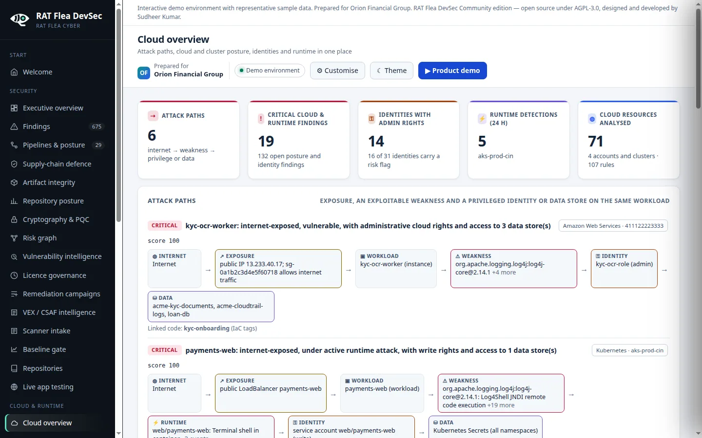
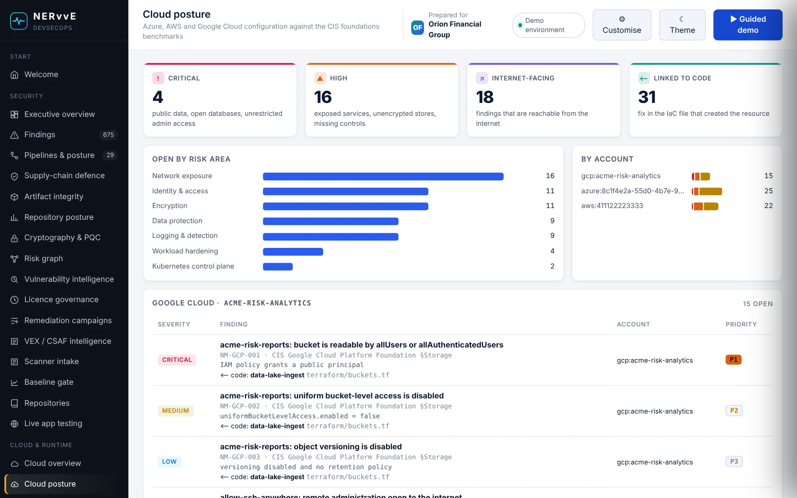
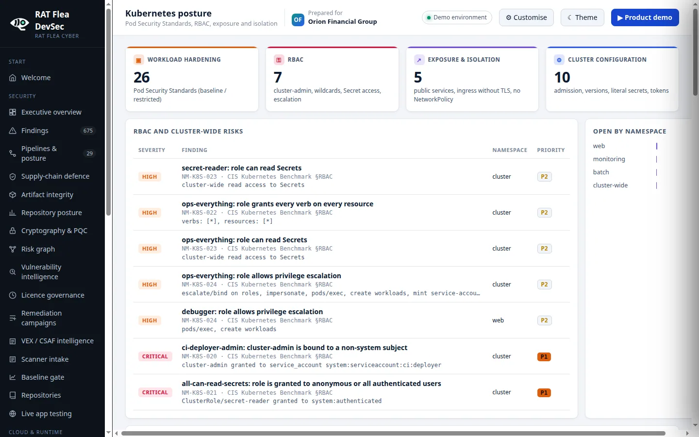
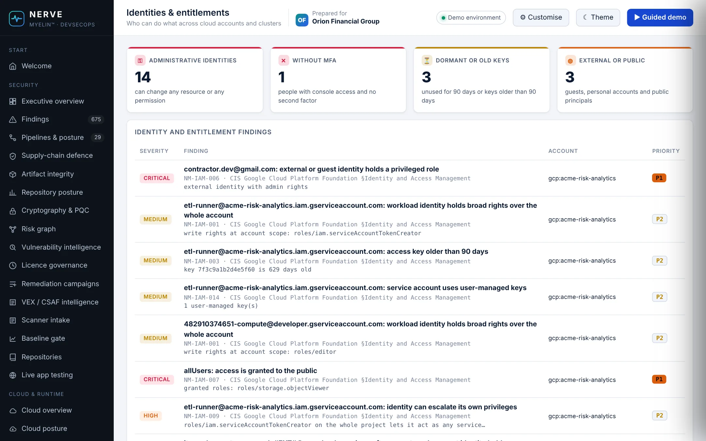
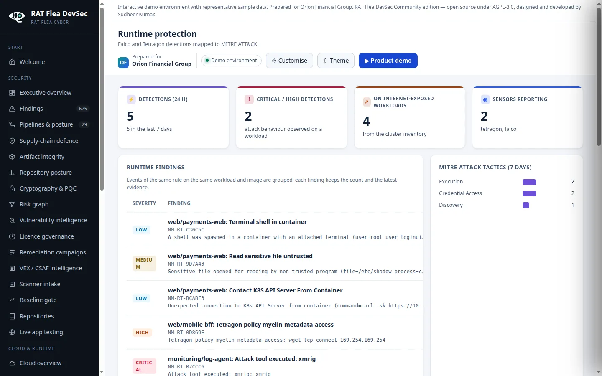
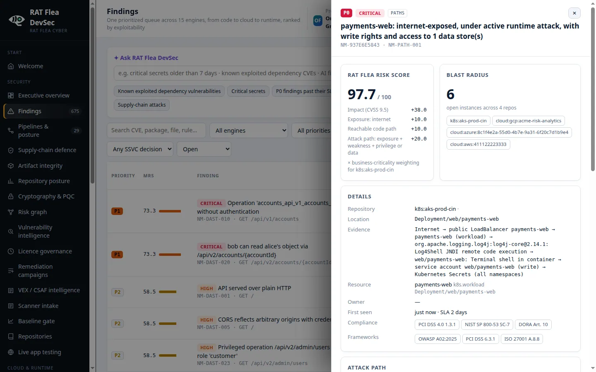

# RAT Flea DevSec — Cloud-native application protection

RAT Flea DevSec Product designed and developed by Sudheer Kumar · <https://github.com/sudheerkumard/nervve-devsecops>

{ .nm-shot }

RAT Flea DevSec covers the cloud and runtime half of the delivery chain with the same finding model, risk score, policy,
ticketing and reports as the code and pipeline engines:

| Capability | What it does | Engine |
|---|---|---|
| Cloud security posture (CSPM) | 67 configuration checks for Microsoft Azure, Amazon Web Services and Google Cloud, grouped by CIS foundations benchmark section | `cspm` |
| Kubernetes security posture (KSPM) | 25 checks: Pod Security Standards, RBAC, exposure, network isolation, admission and node versions | `kspm` |
| Cloud identity & entitlements (CIEM) | 14 checks and an effective-privilege view for Azure role assignments, AWS IAM, Google Cloud IAM and Kubernetes RBAC | `ciem` |
| Runtime workload protection (CWPP) | Falco and Tetragon detections normalised, grouped and mapped to MITRE ATT&CK | `runtime` |
| Attack paths | Internet exposure + exploitable weakness + privileged identity or data store on the same workload | `paths` |
| Code to cloud | Resources and workloads linked to the repository that created them | all |

## 1. Connect

Every collector is read-only and uses the provider's own APIs. Credentials are pasted once and stored in the vault
(OpenBao / HashiCorp Vault); the database holds only a reference.

| Provider | Least privilege | Credential (JSON) | Scope |
|---|---|---|---|
| Azure | Reader, or the custom role in `config/connectors/azure-role-definition.json`; optional Microsoft Graph `Directory.Read.All` for identity names and guest detection | `{"tenant_id", "client_id", "client_secret"}` or `{"tenant_id", "client_id", "federated_token_file"}` | subscription IDs |
| AWS | `SecurityAudit`, or `config/connectors/aws-iam-policy.json`; cross-account role with ExternalId (mandatory) | `{"role_arn", "external_id"}` (or the ambient boto3 chain for the CLI) | regions |
| Google Cloud | `roles/cloudasset.viewer` + `roles/iam.securityReviewer` (`config/connectors/gcp-cloud-posture-roles.md`) | service-account key or `{"access_token"}` (workload identity federation) | `projects/<id>`, `folders/<id>` or `organizations/<id>` |
| Kubernetes | `deploy/k8s/myelin-kspm-reader.yaml` (get/list only; Secrets are never readable) | `{"token", "ca_data"}` | API server URL |

**In the console:** *Cloud overview → Connect a cloud account or cluster* → *Add and collect*. *Collect now* repeats the
collection; findings that are no longer reported are closed as fixed, and regressions reopen.

**From a pipeline or a jump host:**

```bash
myelin cloud scan --provider azure --subscriptions <id1>,<id2> --credential-file azure.json --upload
myelin cloud scan --provider aws --regions ap-south-1,us-east-1 --upload                  # boto3 credential chain
myelin cloud scan --provider gcp --parent projects/acme-prod --credential-file key.json --upload
myelin cloud scan --provider kubernetes --server-url https://api.cluster:6443 --credential-file token.json --upload
```

`--fail-on critical|high|medium` turns the scan into a pipeline gate. The credential can also come from
`MYELIN_CLOUD_CREDENTIAL`; it is never accepted on the command line.

**Air-gapped sites:** collect where the cloud APIs are reachable with `myelin cloud collect ... --out inventory.json`,
carry the file in, and upload it under *Cloud overview → Upload an inventory* or with
`POST /api/v1/cloud/inventory`. Provider-native exports are accepted directly:

| Export | Command |
|---|---|
| Azure Resource Graph rows | `az graph query -q "resources \| project id,name,type,location,resourceGroup,subscriptionId,tags,properties,identity,sku,kind" --first 1000 -o json` (and the `authorizationresources` table for role assignments) |
| Google Cloud Asset Inventory | `gcloud asset export --content-type=resource` and `--content-type=iam-policy` (JSON lines) |
| Kubernetes | `kubectl get ns,deploy,ds,sts,cronjob,job,po,svc,sa,ing,netpol,roles,clusterroles,rolebindings,clusterrolebindings,nodes -A -o json` |

## 2. What is checked

{ .nm-shot }

The catalogue is available at `GET /api/v1/cloud/rules`. Summary:

- **Azure:** storage (anonymous blob access, HTTPS, TLS, network, shared keys), Key Vault (purge protection, network,
  RBAC), SQL (internet firewall rules, public access, Entra ID admin), network security groups (admin and database ports),
  virtual machines (encryption at host, password login), AKS (RBAC, local accounts, public API server, network policy),
  App Service (HTTPS, TLS, FTP, remote debugging), Container Registry (admin user, anonymous pull), Cosmos DB, and Defender
  for Cloud plans.
- **AWS:** S3 (public buckets, Block Public Access, versioning, logging), security groups, EC2 (IMDSv1), EBS default
  encryption, GuardDuty, RDS (public, encryption, backups, deletion protection), CloudTrail (multi-region, validation),
  KMS rotation, EKS (public endpoint, audit logs, secrets encryption), Lambda (unauthenticated URLs, deprecated runtimes).
- **Google Cloud:** buckets (public, uniform access, versioning), firewalls, Compute Engine (default service account,
  serial port, Shielded VM, OS Login), Cloud SQL (internet access, TLS, backups), GKE (legacy ABAC, public control plane,
  Workload Identity, network policy, basic auth), KMS rotation.
{ .nm-shot }

- **Kubernetes:** privileged and root containers, privilege escalation, host namespaces and paths (container-escape
  paths are critical), dangerous capabilities, writable root filesystem, limits, unpinned images, literal secrets in
  environment variables, default service-account tokens, seccomp, default namespace, namespaces without NetworkPolicy
  or Pod Security admission, public LoadBalancers and NodePorts, ingress without TLS, cluster-admin bindings, roles
  granted to anonymous or all authenticated users, wildcard roles, Secret access and privilege-escalation verbs, nodes on
  unsupported versions (`MYELIN_K8S_MIN_MINOR`, default 31). System namespaces are excluded from workload rules
  (`MYELIN_KSPM_EXCLUDE_NS`).
{ .nm-shot }

- **Identities:** workload identities with account-wide rights, privileged users without MFA, access keys older than
  90 days or unused for 90 days, dormant privileged identities, external or guest identities with privileged roles,
  public principals, wildcard custom roles and policies, privilege-escalation permissions, roles assumable by any AWS
  account, root account protection, weak password policy, too many subscription owners, user-managed service-account keys.

Accuracy is tested on labelled sample accounts (`demo/cloud/`, `engine/tests/benchmark/cloud_expected.json`): every
expected finding is reported and nothing else, and compliant resources stay silent.

## 3. Runtime protection

{ .nm-shot }

Install a sensor in each cluster and send its detections to RAT Flea DevSec:

```bash
kubectl create secret generic myelin-runtime -n falco --from-literal=customheaders="X-API-Key:<integration API key>"
helm upgrade --install falco falcosecurity/falco -n falco --create-namespace -f deploy/runtime/falco-values.yaml \
  --set-file customRules."myelin-rules\.yaml"=deploy/runtime/myelin-falco-rules.yaml \
  --set falcosidekick.config.webhook.address="https://<console>/api/v1/runtime/events?cluster=<cluster-name>"
```

Tetragon: apply `deploy/runtime/tetragon-tracingpolicy.yaml` and stream its JSON export with
`myelin runtime forward - --cluster <cluster-name>`. Any sensor can post `{"schema": "myelin-runtime/1", ...}` events.

Events of the same rule on the same workload and image become one finding with a count and the latest evidence; every
event is kept for 30 days for the timeline. Tokens, keys and passwords in command lines are redacted before storage.
A critical or high detection raises the risk score and counts as active exploitation in the SSVC decision. Runtime
findings are linked to the repository through the image name and inherit internet exposure from the cluster inventory.
The sensors (Falco, Tetragon) are open-source projects that the customer installs and operates; RAT Flea DevSec does not
ship a kernel agent of its own.

## 4. Attack paths and code to cloud

{ .nm-shot }

An attack path is reported only when all three conditions hold on one workload, so the list stays short and actionable:

1. **Exposure:** a public IP with an open security group / NSG / firewall, a public LoadBalancer or Ingress, an
   unauthenticated function URL or a public web app.
2. **Weakness:** a critical, high or known-exploited vulnerability in the linked repository or image, a critical or
   high misconfiguration of the workload itself, or a runtime detection.
3. **Impact:** the workload's identity holds administrative rights, or can reach a data store (storage, databases, key
   vaults, Kubernetes Secrets), including across accounts through workload identity (IRSA, GKE Workload Identity, Azure
   workload identity).

Each path is stored as a finding (`NM-PATH-001`, engine `paths`) with its steps, so it is ranked, ticketed, gated and
reported like any other finding; it closes when any link is broken. Resources are linked to code by IaC tags
(`git_repo`, `git_file`, `git_commit`, as written by tagging tools in the IaC pipeline), by the `myelin.io/repo`
annotation on Kubernetes objects, or by the image name. The evidence of every link is shown so it can be confirmed.

## 5. API

| Method | Path | Purpose |
|---|---|---|
| GET | `/api/v1/cnapp` | Overview: coverage, findings by engine, attack paths, identities, code-to-cloud, runtime |
| POST | `/api/v1/cloud/inventory` | Analyse an inventory (RAT Flea, Azure Resource Graph, Cloud Asset export, kubectl) |
| GET / DELETE | `/api/v1/cloud/inventories` | Stored inventories (latest per account or cluster) |
| GET / POST / DELETE | `/api/v1/cloud/accounts` | Cloud accounts and clusters with vault-held credentials |
| POST | `/api/v1/cloud/accounts/{id}/collect` | Collect now (read-only) |
| GET | `/api/v1/cloud/identities` | Effective privilege per identity |
| GET | `/api/v1/cloud/attack-paths` | Attack paths with their steps |
| GET | `/api/v1/cloud/rules` | Rule catalogue |
| POST | `/api/v1/runtime/events` | Runtime detections (one event, a list, JSON lines or `{"cluster", "events"}`) |
| GET | `/api/v1/runtime/events` | Recent runtime events |

Plans: cloud posture, Kubernetes posture, identities, attack paths and runtime protection are included in Business,
Enterprise and Sovereign.

## 6. Boundaries

- Collectors read configuration; they do not read data in storage accounts, buckets or databases, and they never read
  Kubernetes Secrets.
- Exposure is computed from the network rules the collector can see. A firewall or WAF outside the account (for example
  an on-premises proxy) is not known to RAT Flea DevSec; confirm a path before treating it as exploitable.
- Azure identity names and guest status need the optional Microsoft Graph permission; without it identities are shown
  by object ID.
- Runtime detection quality depends on the sensor and its rules; RAT Flea DevSec adds grouping, prioritisation,
  correlation and the workflow around them.

Copyright © 2026 Sudheer Kumar. All rights reserved.
