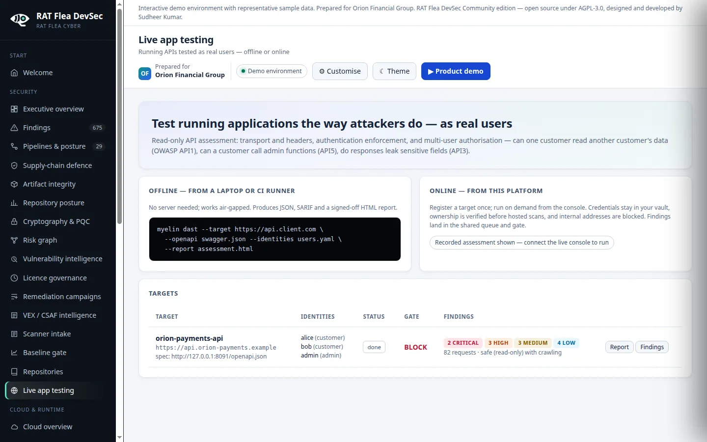

# Live application testing: step-by-step guide (offline and online)

> To scan **source code** (SAST, SCA, secrets, IaC, SBOM) the simplest way is from the console: see
> [SCAN-A-REPOSITORY.md](SCAN-A-REPOSITORY.md). This guide covers testing **running** APIs.

{ .nm-shot }

NERvvE DevSecOps tests a **running** API the way real users use it: it checks transport and headers, checks that
protected endpoints really need a login, checks whether one customer can read another customer's data (OWASP API1),
whether a customer can call admin functions (API5) and whether responses leak sensitive fields (API3).
All checks are **read-only** (GET / HEAD / OPTIONS) and stay within a fixed request budget.

There are two ways to run it:

| | Offline (CLI) | Online (console) |
|---|---|---|
| Where it runs | Your laptop or a CI runner | The NERvvE DevSecOps platform |
| Server needed | No | Yes (the platform) |
| Where test-account tokens live | Environment variables on your machine | A secret vault (OpenBao / Vault, Azure Key Vault, AWS Secrets Manager) |
| Ownership proof | Not checked (you confirm authorisation) | Required: a file on the target website |
| Private / internal addresses | Allowed | Blocked |
| Output | JSON, SARIF, HTML report | Results, gate decision and report in the console; findings in the shared queue |

> Only test applications you own, or that you have **written permission** to test.

**Worked example used throughout this guide**

| | |
|---|---|
| Customer | Acme Bank |
| API | `https://api.acmebank.example` |
| OpenAPI spec | `https://api.acmebank.example/swagger/v1/swagger.json` |
| Test accounts | `customer-a`, `customer-b` (ordinary customers), `admin` (an administrator) |

---

## Part 1 — Get the test-account tokens (needed for both modes)

The multi-user tests need **at least two** accounts of the application being tested. Add an admin account to also
test whether customers can reach admin functions.

1. **Create test accounts** in the customer's application (never real customer accounts): two ordinary customers and,
   optionally, one administrator. Give each one some data of its own (an order, a profile, an account).
2. **Get a token for each account.** The token is the value the application sends in the `Authorization` header after
   login, usually `Bearer eyJ...`. Any of these works:
   - **Browser:** sign in to the application → press **F12** → **Network** tab → click any API call → **Request Headers**
     → copy the whole value after `Authorization:`, e.g. `Bearer eyJhbGciOiJIUzI1NiIs...`.
   - **Login API** (if the application has one):
     ```powershell
     curl.exe -s -X POST https://api.acmebank.example/api/auth/login -H "Content-Type: application/json" `
       --data-binary "@login-customer-a.json"
     ```
     where `login-customer-a.json` holds `{"username": "customer-a", "password": "..."}`. Copy the `access_token` from the
     reply and put `Bearer ` in front of it.
   - **Postman / Insomnia:** the same login request; copy the token from the response.
   - **API keys:** if the application uses a key header such as `X-API-Key`, use that header name and the key itself
     (no `Bearer`).
3. **Note the expiry.** Most tokens expire after 15 minutes to a few hours. Get them shortly before the scan, and get a
   fresh one if a run reports authentication failures.

If the application has **no login at all**, skip this part: both modes still run the single-user checks.

---

## Part 2 — Offline scan (CLI, from a laptop or CI)

### 2.1 One-time setup (Windows)

```powershell
cd C:\Users\<you>\nerve-myelin
powershell -ExecutionPolicy Bypass -File scripts\windows\setup-myelin.ps1
.\.venv\Scripts\Activate.ps1
myelin --help
```

### 2.2 Put the tokens in environment variables (not in files)

```powershell
$env:ACME_CUSTOMER_A = "Bearer eyJ...token of customer-a..."
$env:ACME_CUSTOMER_B = "Bearer eyJ...token of customer-b..."
$env:ACME_ADMIN      = "Bearer eyJ...token of admin..."
```

These exist only in this PowerShell window and disappear when you close it.

### 2.3 Write the identities file

Create `acme-identities.yaml` (it holds **references** to the variables, not the tokens):

```yaml
identities:
  - name: customer-a
    role: customer
    headers: { Authorization: "env:ACME_CUSTOMER_A" }
  - name: customer-b
    role: customer
    headers: { Authorization: "env:ACME_CUSTOMER_B" }
  - name: admin
    role: admin
    headers: { Authorization: "env:ACME_ADMIN" }
cross_user_roles: [admin]          # admins may legitimately read everyone's data
privileged:                        # optional: endpoints only admins may call
  - path: /api/admin/*
    roles: [admin]
```

A full example is in `demo/vulnerable-api/identities.example.yaml`.

### 2.4 Run the scan

```powershell
myelin dast --target https://api.acmebank.example `
  --openapi https://api.acmebank.example/swagger/v1/swagger.json `
  --identities acme-identities.yaml `
  --report acme-assessment.html --customer "Acme Bank"
```

Useful options:

| Option | Purpose |
|---|---|
| `--max-requests 600` | Raise the request budget for large APIs (default 300) |
| `--delay 0.5` | Slow down for fragile or rate-limited APIs (seconds between requests, default 0.2) |
| `--insecure` | Continue when the TLS certificate is untrusted (still reported as a finding) |
| `--zap` | Also run the OWASP ZAP passive baseline in Docker |

Without accounts, leave out `--identities`. Without a spec, leave out `--openapi`; fewer endpoints are tested.

### 2.5 Read the results

- The terminal shows the findings and the gate decision (**pass**, **warn** or **block**).
- `acme-assessment.html` is the signed-off report for the customer. Open it in a browser and print or save it as PDF.
- Add `--sarif acme.sarif` and `--json acme.json` for machine-readable output (SARIF uploads to the code-scanning view in CI). The command exits with code 1 on a **block** decision, which fails a CI job (`--fail-on warn` or `--fail-on never` changes this).

---

### 2.6 Send the results to the console (optional)

Offline results stay on your machine unless you upload them. To see them in the console (Findings, Repositories,
Supply chain, Executive overview):

1. In the console, open **Integrations → Send scan results to this console → Create API key** (organisation
   administrators). Copy the key; it is shown only once.
2. Set the server and key, then run the same commands. Results are uploaded at the end of each run:
   ```powershell
   $env:MYELIN_SERVER  = "https://myelin.localtest.me:8443"
   $env:MYELIN_API_KEY = "<the key>"
   myelin scan C:\src\acme-api --repo acme-api                    # code scan -> Repositories, Findings, Supply chain
   myelin dast --target https://api.acmebank.example --identities acme-identities.yaml --report acme-assessment.html
   ```
3. In CI, store the key as a pipeline secret named `MYELIN_API_KEY` and set `MYELIN_SERVER` the same way.

If the upload fails with `CERTIFICATE_VERIFY_FAILED` (the evaluation stack uses its own local certificate authority),
point the CLI at that certificate. `start-enterprise.ps1` saves it on every start:
```powershell
$env:MYELIN_CA_FILE = "$env:TEMP\myelin-local-ca.crt"
```

## Part 3 — Online scan (from the console)

### 3.1 Start the platform (evaluation stack on Windows)

```powershell
cd C:\Users\<you>\nerve-myelin
git pull
powershell -ExecutionPolicy Bypass -File scripts\windows\start-enterprise.ps1
```

Docker Desktop must show **Engine running** first. The script starts the database, sign-in, the secret vault, the API
and the console, then opens **https://myelin.localtest.me:8443**. Sign in. The top bar must say
**Secure session · MFA**. If it says **Demo environment**, you are looking at the offline demo page, not the platform.

> **Back up `%USERPROFILE%\nerve-keys\openbao-init.json`.** It unlocks the local vault. Without it, stored tokens
> cannot be read and the stack has to be reset.

### 3.2 Store each test account's token in the vault

Run the command once per account. `-Tenant` is the organisation you sign in to (`acme` for alice-admin and sam-lead,
`globex` for gary-admin):

```powershell
powershell -ExecutionPolicy Bypass -File scripts\windows\myelin-secret.ps1 -Tenant acme -Name customer-a
powershell -ExecutionPolicy Bypass -File scripts\windows\myelin-secret.ps1 -Tenant acme -Name customer-b
powershell -ExecutionPolicy Bypass -File scripts\windows\myelin-secret.ps1 -Tenant acme -Name admin -Role admin
```

At the prompt **Authorization header value ... input is hidden**, paste the token with a **right-click** (nothing is
shown while you type or paste) and press **Enter**. Each command prints:

```
  [ok]   stored 'customer-a' for organisation 'acme' in the local vault

Identity line for the console (Test identities):
  {"name": "customer-a", "role": "customer", "headers": {"Authorization": "vault://secret/myelin/tenants/6f1c.../dast/customer-a#token"}}
```

Rules:
- Always type the parameter names (`-Tenant`, `-Name`, `-Role`). Loose words are rejected.
- `-Name` is a label for the **test user** (`customer-a`), not the product or customer name.
- For an API-key header, add `-Field X-API-Key` and paste the key.
- When a token expires, run the same command again with the same name. The reference does not change, so the target
  does not need to be edited.

**Production installations** use the customer's own vault instead of the local one. The reference path must contain
the tenant id shown in the console form, for example:
- HashiCorp Vault / OpenBao: `vault://secret/myelin/tenants/<tenant-id>/dast/customer-a#token`
- Azure Key Vault: `azkv://kv-acme-security/myelin-<tenant-id>-dast-customer-a`
- AWS Secrets Manager: `awssm://eu-west-1/myelin/<tenant-id>/dast/customer-a#token`

### 3.3 Register the target

**Live app testing → + Register target**, then fill in:

| Field | Example |
|---|---|
| Name | `Acme Bank API` |
| Base URL | `https://api.acmebank.example` (https only, no path) |
| OpenAPI spec URL | `https://api.acmebank.example/swagger/v1/swagger.json` (optional) |
| Criticality | `high` for customer-facing or financial APIs |
| Test identities | the printed lines inside `[ ]`, separated by commas |

```json
[
 {"name": "customer-a", "role": "customer", "headers": {"Authorization": "vault://secret/myelin/tenants/6f1c.../dast/customer-a#token"}},
 {"name": "customer-b", "role": "customer", "headers": {"Authorization": "vault://secret/myelin/tenants/6f1c.../dast/customer-b#token"}},
 {"name": "admin", "role": "admin", "headers": {"Authorization": "vault://secret/myelin/tenants/6f1c.../dast/admin#token"}}
]
```

Use `[]` for an application without logins. Click **Register**.

### 3.4 Prove ownership of the website

Hosted scans only run against sites whose owner has proved control.

1. Click **Verify ownership** on the target. The panel shows the token (`myelin-verify-...`) and the exact address.
   Click **Copy token** or **Download myelin-verification.txt**.
2. Make the website return that token at:
   ```
   https://api.acmebank.example/.well-known/myelin-verification.txt
   ```
   The address must return **HTTP 200 with the token**, without a redirect. Where to put the file:

   | Hosting | Where the file goes |
   |---|---|
   | cPanel / shared hosting (File Manager or SSH) | `.well-known/` inside the **domain's own folder** (see note below) |
   | Azure App Service | Kudu → Debug console → `site/wwwroot/.well-known/` |
   | IIS, nginx, Apache (own server) | `.well-known/` in the site's web root |
   | ASP.NET Core | `app.MapGet("/.well-known/myelin-verification.txt", () => Results.Text("myelin-verify-..."));` |
   | Static hosts (Netlify, Vercel, GitHub Pages) | add `.well-known/myelin-verification.txt` to the site and redeploy |

   With SSH (cPanel example, where the domain's folder is `~/api.acmebank.example`):
   ```bash
   cd ~/api.acmebank.example
   mkdir -p .well-known
   echo "myelin-verify-PASTE-YOUR-TOKEN" > .well-known/myelin-verification.txt
   chmod 755 .well-known && chmod 644 .well-known/myelin-verification.txt
   ```
3. Test it from your laptop. It must print only the token:
   ```powershell
   curl.exe -s https://api.acmebank.example/.well-known/myelin-verification.txt
   ```
4. Click **Check now**. The target shows **✓ ownership verified**. You can delete the file afterwards.

**Shared-hosting pitfalls** (seen on cPanel / LiteSpeed):

| What `curl.exe` shows | Cause | Fix |
|---|---|---|
| The site's own "Page not found" page | File is in the wrong folder: an addon domain has its own folder (e.g. `~/api.acmebank.example`), not `public_html` | Run `ls ~` to find the domain's folder and put `.well-known` there |
| "403 Forbidden" | `.htaccess` blocks all dot-folders (e.g. `RewriteRule (^|/)\. - [F,L]`) | Add an exception at the **top** of that folder's `.htaccess` (below) |
| A redirect (301/302) | `http`→`https` or `www` redirect | Register the exact address that answers without redirecting |
| `myelin-verify-XXXX` (placeholder) | The example value was copied, not your token | Copy the real token from the Verify ownership panel |

`.htaccess` exception, placed above every other rule:
```apache
RewriteEngine On
RewriteRule ^\.well-known/ - [L]
<If "%{REQUEST_URI} =~ m#^/\.well-known/#">
  Require all granted
</If>
```

### 3.5 Run the assessment

Click **▶ Run**. The button shows **Running…** while the scan works. When it finishes, the row shows the gate decision
(**PASS / WARN / BLOCK**), the findings by severity and the number of requests, with **Report** (the signed-off HTML
report) and **Findings** (the findings in the shared queue, alongside code and dependency findings).

While a scan runs, the row shows **running · started N min ago** and refreshes by itself every few seconds. If a run
fails, the reason is shown under the status (for example a wrong spec URL) and **Run** can be clicked again.

**Edit** changes the spec URL, criticality or test identities (leave identities empty to keep them). The address cannot
change, so ownership stays verified. **Delete target** is inside the Edit panel.

---

## How long does a scan take?

The scanner sends one request about every 0.2 seconds plus the API's response time, so in practice 2–4 requests per
second, and it stops at the request budget.

| Scope | Requests (typical) | Time (typical) |
|---|---|---|
| No spec, no accounts (transport, headers, common exposures) | 30–80 | **under 1 minute** |
| Spec with ~20 endpoints, no accounts | 80–200 | **1–2 minutes** |
| Spec with ~20 endpoints, 2–3 accounts (multi-user tests) | 200–600 | **2–5 minutes** |
| Large API (100+ endpoints), 3 accounts | up to the budget: 300 offline, 1,500 online | **5–12 minutes** |
| Adding `--zap` (passive baseline, offline only) | — | **+5–15 minutes** |

Times grow with slow APIs (each request waits up to 15 seconds), `--delay` and larger budgets. Verification itself
takes a few seconds. Tokens must still be valid at the end of the scan, so get them shortly before you start.

---

## Troubleshooting

| Message | Meaning and fix |
|---|---|
| "verify ownership first: serve /.well-known/myelin-verification.txt..." | **Run** was clicked before verification succeeded. Complete 3.4, then run again. |
| "credential_ref path must contain your tenant id" | Use the line printed by `myelin-secret.ps1`. The console form also shows your tenant id. |
| "Identities must be valid JSON" | Check brackets and commas: `[ {...}, {...} ]`. |
| "authorisation testing needs at least two identities" | Add a second account, or use `[]` for single-user checks. |
| "secret not found in Vault" | The account was not stored for this organisation. Run `myelin-secret.ps1` with the right `-Tenant` and `-Name`. |
| Many 401 responses or "authentication failed" in the results | The application's tokens expired. Store fresh ones (same `-Name`) and run again. |
| "could not fetch the OpenAPI spec (HTTP 404)" or "... is not an OpenAPI/Swagger document" | The spec URL is wrong or the site has no spec. Check it with `curl.exe -s <spec URL>`. Click **Edit** on the target and correct the URL, or clear it to scan without a spec. Ownership stays verified. |
| Status stays **running** much longer than the times above | The run was interrupted (for example the platform restarted). After 30 minutes it shows as **failed — interrupted** and **Run** works again. |
| "... which is not allowed for online scanning" | Online scans refuse localhost and private networks. Use the offline CLI for internal APIs. |
| "online targets must use https" | Register the https address. |
| The console shows "Demo environment" | You opened the offline demo page. Start the platform (3.1) and open https://myelin.localtest.me:8443. |
