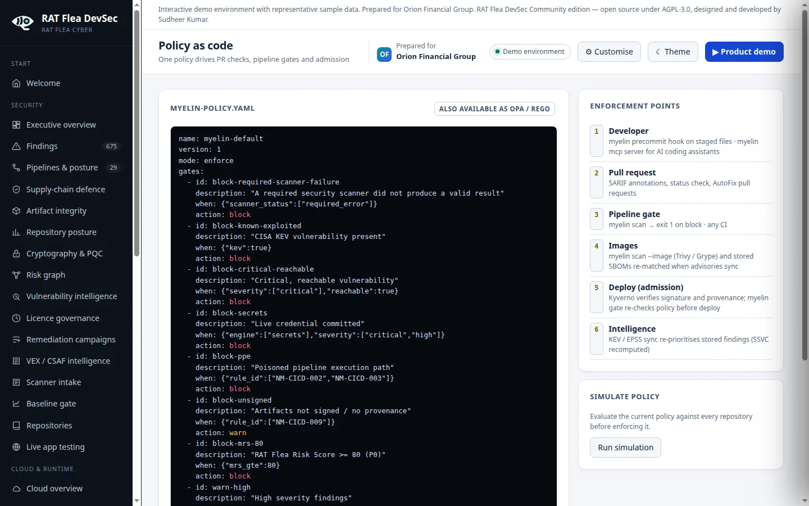

# RAT Flea DevSec Policy Governance Lifecycle

{ .nm-shot }

Copyright (c) 2026 Sudheer Kumar. Licensed under the GNU AGPL-3.0.

## Purpose

This release adds an auditable policy lifecycle to the existing MYELIN policy evaluator. Policy content is versioned and immutable. Publication requires an independent reviewer. Only published versions can be attached to organisation, project or repository scopes.

## Lifecycle

1. A user with \`policies:write\` creates an immutable draft. The API assigns the next version number and calculates SHA-256 over canonical JSON.
2. The author submits the draft for approval. Its lifecycle status changes from \`draft\` to \`pending\`.
3. A different authenticated principal with \`policies:approve\` reviews the request with a mandatory note. The requester cannot approve or reject their own request.
4. Approval changes the version to \`published\`; rejection changes it to \`rejected\`. Both decisions are recorded in the append-only audit chain.
5. A user with \`policies:write\` binds a published version to an organisation, project or repository.
6. Effective policy resolution applies organisation → project → repository layers. A more-specific gate or exception with the same ID replaces the inherited definition; entries with other IDs remain inherited. Repository project membership is persisted by a policy administrator and is never trusted from scanner request payloads. The most-specific layer that declares a mode supplies the effective mode.
7. Rollback creates a new immutable draft using the selected historical version's content. It does not edit or reactivate historical content. The rollback draft must pass the same approval process.

## RBAC

| Role | Author / submit | Approve / reject | Bind |
|---|---:|---:|---:|
| security_lead | Yes | No | Yes |
| policy_approver | No | Yes | No |
| tenant_admin | Yes | Yes | Yes |
| auditor | No | No | No |
| developer / viewer | No | No | No |

Map an IdP group to the dedicated role in \`config/backend/identity-providers.yaml\`:

\`\`\`yaml
role_mapping:
  myelin-security-lead: security_lead
  myelin-policy-approver: policy_approver
\`\`\`

A tenant administrator has both permissions, but the API still rejects self-approval by comparing the authenticated actor with the original requester. Use separate named identities for author and reviewer in production. The `policy_approver` role is deliberately excluded from API-key issuance.

## API

All endpoints require the permission named below and use the tenant from the validated identity, never from a request field.

| Method and path | Permission | Purpose |
|---|---|---|
| \`GET /api/policies/versions\` | policies:read | List tenant policy versions and content |
| \`POST /api/policies/versions\` | policies:write | Create an immutable draft |
| \`POST /api/policies/versions/{id}/request-approval\` | policies:write | Submit draft |
| \`GET /api/policies/approvals\` | policies:read | List approval requests |
| \`POST /api/policies/approvals/{id}/review\` | policies:approve | Approve or reject with rationale |
| \`POST /api/policies/versions/{id}/rollback\` | policies:write | Stage historical content as a new draft |
| \`GET /api/policies/bindings\` | policies:read | List current scope bindings |
| \`PUT /api/policies/bindings\` | policies:write | Bind a published version |
| \`GET /api/policies/effective?project=...&repo=...\` | policies:read | Explain effective policy layers |
| \`POST /api/policies/evaluate?project=...&repo=...\` | findings:read | Evaluate findings against effective policy |

Create draft example:

\`\`\`http
POST /api/policies/versions
Content-Type: application/json

{
  "name": "production",
  "content": {
    "mode": "enforce",
    "gates": [
      {
        "id": "block-critical-reachable",
        "description": "Block critical reachable vulnerabilities",
        "when": {"severity": ["critical"], "reachable": true},
        "action": "block"
      }
    ],
    "exceptions": []
  }
}
\`\`\`

Submit for approval:

\`\`\`http
POST /api/policies/versions/{version-id}/request-approval
\`\`\`

Independent reviewer decision:

\`\`\`http
POST /api/policies/approvals/{request-id}/review
Content-Type: application/json

{
  "decision": "approved",
  "note": "Reviewed the rule scope and confirmed the required enforcement behaviour."
}
\`\`\`

Bind after approval:

\`\`\`http
PUT /api/policies/bindings
Content-Type: application/json

{
  "policy_version_id": "{published-version-id}",
  "scope_type": "repository",
  "scope_key": "payments-api"
}
\`\`\`

## Persistence and security

Migration \`0006_policy_governance.py\` creates \`policy_versions\`, \`policy_approval_requests\` and \`policy_bindings\`. Each table has tenant identity, forced PostgreSQL row-level security and application-role grants. Policy version content, version number, name, creator and digest are protected by a database trigger. Deletion of policy versions is rejected by a database trigger. Publication metadata and lifecycle status may change without changing the policy definition.

The application audit chain records version creation, approval request, approval/rejection, binding changes and rollback draft creation. Policy content is hashed from canonical JSON with sorted keys and compact separators.

## Operational rollout

1. Back up the PostgreSQL database and verify the migration owner credentials.
2. Apply migration using the documented migration command and owner-role connection.
3. Restart the API using the least-privilege application role.
4. Configure IdP role mappings for policy authors and independent approvers.
5. Verify \`GET /api/health/ready\`, policy version APIs, RLS isolation and audit chain integrity.
6. Create a test draft, approve from a different identity, bind to a non-production repository, and verify the effective policy.
7. Map each repository to its trusted project through `PUT /api/policies/repository-projects` before enabling project-level policies. Scan payloads cannot select their own project. An unmapped repository fails closed while project-level bindings exist.
8. Confirm existing scans continue to use the built-in YAML policy until a published scoped version is bound.

Do not apply the migration to a customer database until the migration and RLS integration tests pass in CI and the deployment operator has reviewed the backup and rollback plan. A downgrade removes the three governance tables and therefore deletes their records; it is not a production rollback strategy. To revert policy behaviour, create and approve a new version from the desired historical content.

## Current boundaries

- Approval requests and policy versions are tenant-persisted. There is one approval request per policy version.
- A binding stores the current version for a scope; binding history is available through the append-only audit chain.
- Inheritance is deterministic and explainable through the effective-policy response.
- The current workflow does not yet include time-limited policy exceptions as separately approved records, scheduled activation, or policy-decision evidence bundles. These remain subsequent work.
- The demo console is read-only for this workflow. Real publication approvals must use authenticated live mode and distinct identities.
