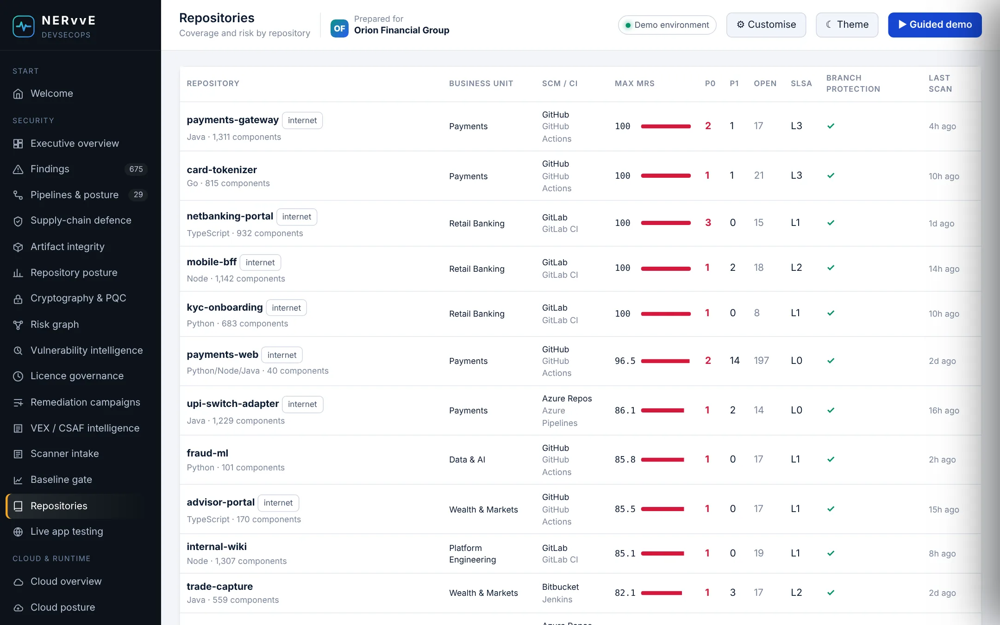

# Scan a repository from the console

{ .nm-shot }

The quickest way to get a full code security report. No command line, no API keys.

1. Sign in to the console and open **Repositories**.
2. Click **＋ Add repository**.
3. Paste the repository address — GitHub, GitLab, Bitbucket, Azure DevOps, AWS CodeCommit, Google Cloud or any Git
   server (see [SOURCE-PROVIDERS.md](SOURCE-PROVIDERS.md) for each address format and credential). Leave **Branch** empty for the default branch.
4. **Private repository?** Paste a read-only access token:
   - **GitHub:** Settings → Developer settings → Personal access tokens → **Fine-grained tokens** → *Generate new token* →
     Repository access: *Only select repositories* → choose the repository → Permissions → **Contents: Read-only**.
   - **GitLab:** the project → Settings → **Access tokens** → scope **read_repository**, role *Reporter*.

   The token goes straight into the secret vault. The platform keeps only a reference, and the token is never shown again.
5. Click **Add and scan**. A typical repository takes under a minute; the row refreshes by itself.

When the scan finishes, the row shows the gate decision (**PASS / WARN / BLOCK**) and the findings by severity and engine.

| Button | What you get |
|---|---|
| **Full report** | One HTML report with every engine: code analysis (SAST), open-source dependencies (SCA), secrets, Infrastructure as Code, pipeline posture, licences, AI components and the full SBOM. **Download PDF / print** at the top saves it as PDF. |
| **SBOM** | The CycloneDX 1.5 software bill of materials (JSON). |
| **Scan again** | A fresh snapshot of the same branch. |
| **Remove** | Removes the repository and deletes its token from the vault. Findings history is kept. |

The findings also appear in **Findings**, **Supply chain**, **Pipelines & posture** and **Executive overview**, together with
results from CI pipelines and live-app tests.

## What each engine checks

| Engine | How it works |
|---|---|
| Open-source dependencies (SCA) | Every component from the manifests **and its transitive dependencies** (lockfiles: package-lock, yarn.lock, poetry.lock, Pipfile.lock; Python requirements are resolved from PyPI). Vulnerabilities come live from **OSV** (all major ecosystems, with CVSS severity and fixed versions), with the PyPI advisory database as fallback and the bundled pack offline. Each finding says whether the package is direct or comes in through another one. |
| Licences | Licence of every component from the package registries. Strong copyleft (GPL, AGPL, SSPL) is flagged high; weak copyleft (LGPL, MPL, EPL) is listed as information. |
| Code analysis (SAST) | NERvvE DevSecOps rules (injection, SSRF and `file://` URL access, disabled TLS/JWT verification, unsafe deserialisation, weak crypto, predictable tokens, XXE, DOM XSS, command injection) plus **Bandit** for Python. |
| Secrets | Cloud keys, tokens, private keys, credential assignments, and **default/demo passwords written in code, config, docs or login pages**. Test folders are skipped. |
| Infrastructure as Code | Dockerfiles (root user, health check, unpinned base, TLS-off installs, `curl | sh`, secrets in ENV/ARG), Docker Compose (privileged, Docker socket, host namespaces, dangerous capabilities, published database ports, hard-coded secrets) and Kubernetes (privileged, host namespaces, root, privilege escalation, capabilities, limits, image pinning, service-account tokens, secrets in env); Terraform/Bicep patterns. |
| Pipeline posture, AI components | GitHub Actions / GitLab / Azure Pipelines risks; models, prompts and agent tools. |

The report's **Vulnerability data** line shows which sources were reachable during the scan.
**Air-gapped installations:** set `MYELIN_OFFLINE=1` (bundled advisory pack only) or point to internal mirrors with
`MYELIN_OSV_URL`, `MYELIN_PYPI_URL`, `MYELIN_NPM_URL`.

## What happens to the code

The platform downloads a read-only snapshot through the provider's API (github.com or gitlab.com only), extracts it into a
private temporary folder (links, devices and path escapes are skipped; size limits apply), scans it and deletes it. Source
code is not retained. Only users with the scan permission (security lead, tenant admin) can add or scan repositories;
viewers and auditors can read the reports. Each organisation sees only its own repositories.

## Troubleshooting

| Message | Fix |
|---|---|
| "the provider answered HTTP 404 / 403 ..." | The address is wrong, or the repository is private and the token is missing, expired or lacks **Contents: Read-only** (GitHub) / **read_repository** (GitLab). Remove the repository and add it again with a new token. |
| "private repositories need a secret vault" | The installation has no vault configured. The Windows evaluation stack includes one; in production configure Vault / OpenBao (`VAULT_ADDR`). |
| "the repository archive is larger than 300 MB" | Very large monorepositories: scan them in CI with `myelin scan` instead. |
| "the vault refused to store the token" | The vault policy is read-only. Re-run `start-enterprise.ps1` (it updates the policy), or ask your vault administrator to allow create/update on `secret/data/myelin/tenants/*`. |
