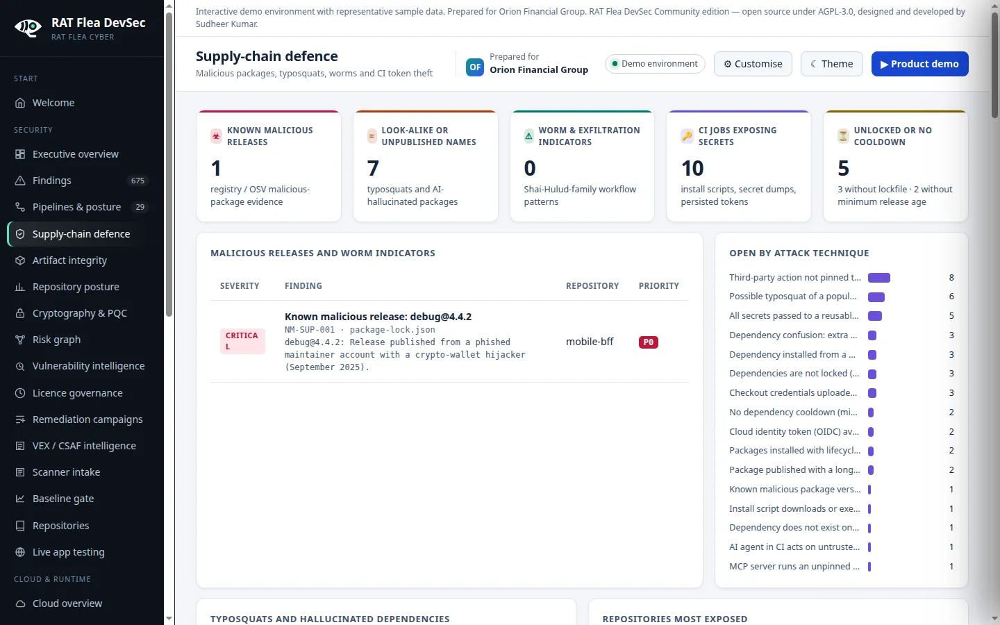
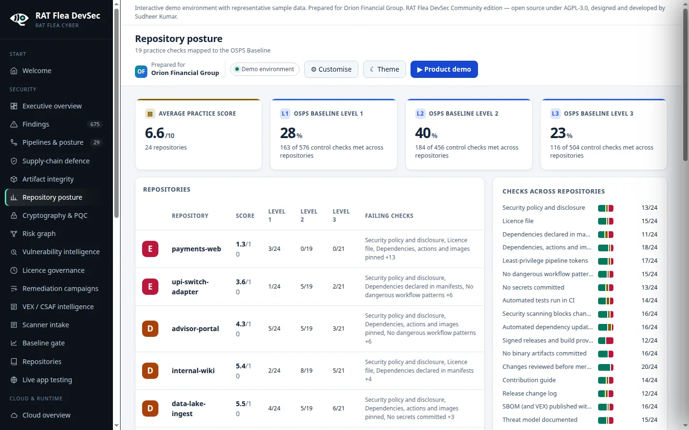

# Supply-chain defence, SSVC, repository posture, cryptography (CBOM) and EU CRA

NERVE Myelin Product designed and developed by Sudheer Kumar · <https://github.com/sudheerkumard/nerve-myelin-DevSec>

{ .nm-shot }
{ .nm-shot }

## Supply-chain defence engine (`supply`)

| Rule | What it reports | Severity |
|---|---|---|
| NM-SUP-001 | Known malicious package release: bundled indicator pack (offline) and OSV malicious-package advisories (`MAL-`) when online | critical |
| NM-SUP-002 | Possible typosquat: one edit or a separator change away from a popular npm / PyPI package (known independent packages excluded) | high |
| NM-SUP-003 | Direct dependency not published on the public registry (possible AI-hallucinated name). Online only; skipped when a private registry is configured | high |
| NM-SUP-004 | Dependency confusion: `--extra-index-url` in requirements, pip config, Dockerfiles or CI | high |
| NM-SUP-005 | Manifest without a lockfile (a lockfile in a parent folder covers workspaces) | medium / low |
| NM-SUP-006 | Dependency from a git branch, URL or tarball instead of the registry (git pinned to a full SHA is accepted) | medium / high for http |
| NM-SUP-007 | Dependencies that run install-time scripts (`hasInstallScript` in package-lock; common native builds allow-listed) | low |
| NM-SUP-008 | No dependency cooldown: npm `min-release-age`, pnpm `minimumReleaseAge`, Yarn `npmMinimalAgeGate` | low |
| NM-SUP-009 | The project's own lifecycle script downloads or runs remote code | high |
| NM-SUP-010 | Worm / exfiltration indicator: known workflow names and endpoints, discussion-triggered backdoors on self-hosted runners, secret dumps sent over the network | critical |

## CI hardening against token theft (`cicd`, NM-CICD-013…021)

`toJSON(secrets)` · `secrets: inherit` · install with lifecycle scripts in jobs that hold tokens · cache in `pull_request_target` / `workflow_run` ·
checkout credentials uploaded as an artifact · `ACTIONS_ALLOW_UNSECURE_COMMANDS` · `id-token: write` on untrusted triggers ·
artifacts from an untrusted run downloaded into a privileged workflow · `npm publish` with a stored token and no provenance.

## AI coding agents (`aibom`, NM-AI-028…032)

Hidden Unicode in AGENTS.md / CLAUDE.md / GEMINI.md / Cursor, Windsurf, Cline, Copilot, Junie and Amazon Q rule files · instructions to bypass
security or hide actions (prohibitions such as "never disable TLS verification" are not reported) · approvals switched off in committed agent
settings (`bypassPermissions`, `Bash(*)`, `chat.tools.autoApprove`, `autoAccept`, `enableAllProjectMcpServers`) · agents in CI acting on
issue / comment / PR text (critical with approvals disabled) · agents launched with sandboxing disabled in scripts.
AI rules carry the OWASP Top 10 for Agentic Applications (2026) category (`owasp_agentic`).

## CISA SSVC

Every finding has `ssvc = {decision, exploitation, automatable, technical_impact, mission_wellbeing}` on the CISA tree (Track, Track*, Attend, Act).
Filter with `GET /api/findings?ssvc=Act`. Decisions are recomputed on read so new KEV / EPSS data applies to stored findings.

## Repository posture and OSPS Baseline

`GET /api/v1/posture` (all repositories) and `/api/v1/posture/{repo}`: 19 checks, score 0–10 and grade A–E, OSPS Baseline 2026.08.28 controls as
met / partial / not met / attestation needed.

## Cryptography inventory and post-quantum readiness

`GET /api/v1/pqc` (readiness across repositories) and `/api/v1/cbom/{repo}` (CycloneDX 1.6 CBOM). Classes: broken, quantum-vulnerable,
review, quantum-safe. The inventory and posture travel inside the stored SBOM as metadata properties and are removed from SBOM exports.

## EU Cyber Resilience Act

`GET /api/v1/cra`: Article 14 clocks (24 h early warning, 72 h notification, final report 14 days after a fix) for actively exploited
vulnerabilities (KEV or malicious release) and the Annex I evidence per product. `POST /api/v1/cra/{finding}` with
`{"stage": "aware|early_warning|notification|final_report", "reference": "...", "note": "..."}` records a milestone (audited).
A planning aid, not legal advice; submissions go through the ENISA Single Reporting Platform.

## Frameworks

Findings now map to OWASP Top 10:2025 (A03 Software Supply Chain Failures, A10 Mishandling of Exceptional Conditions), the OWASP Top 10 for
Agentic Applications (2026) and EU CRA Annex I, in addition to the existing frameworks.
