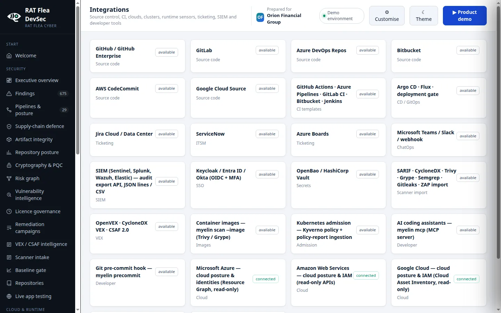

# Ticketing: Jira, ServiceNow, Azure Boards, Microsoft Teams / Slack

{ .nm-shot }

RAT Flea DevSec turns findings into assigned work items and keeps them in step with the code.

* **One ticket per finding, never duplicated.** The ticket reference is stored on the finding (`SEC-123 ↗` in the console).
* **Assigned to the right team.** Routing rules match repository (wildcards), engine and minimum priority; first match wins.
* **Automatic or manual.** Automatic mode raises tickets after every scan for new findings at or above a priority (P0, P0–P1,
  …; at most 25 per scan, the rest can be raised from Findings). Any finding can also be raised by hand: **Findings → open a
  finding → 🎫 Create ticket**.
* **Closed loop.** When a re-scan no longer sees the issue, the ticket gets a comment naming the commit and is resolved
  (Jira transition, ServiceNow resolution, Azure Boards state). If the issue returns, the ticket gets a comment.
* Every ticket carries the CVE / advisory, CWE, package and fixed version, file and line, evidence, risk score, SLA and the fix.

## Set up (Integrations → Ticketing → ＋ Add ticketing system)

| System | Fields | Credential |
|---|---|---|
| **Jira Cloud** | Address `https://<site>.atlassian.net`, account e-mail, project key, issue type (Bug), status to move to when fixed (Done), default assignee (account ID) | API token of an integration account (id.atlassian.com → Security → API tokens) with *Browse*, *Create*, *Add comments*, *Transition issues* in the project |
| **Jira Data Center** | Address, project key, issue type, resolve status, default assignee (username) | Personal access token |
| **ServiceNow** | Instance address, table (`incident` by default; any table such as a custom security table), default assignment group, category | `username:password` of an integration user with the *itil* role, or `Bearer <OAuth token>` |
| **Azure DevOps Boards** | Organisation, project, work item type (Bug / Task / Issue), area path, state when fixed (Done / Closed / Resolved), default assignee (e-mail) | PAT with **Work Items: Read & write** |
| **Webhook** | HTTPS address of a Teams / Slack incoming webhook or any endpoint | Optional header, e.g. `Authorization: Bearer …` |

**Save and test** checks the credential and the project/table before anything is created. The credential goes to the
secret vault; only organisation administrators can add, change or remove integrations (permission `connectors:manage`);
security leads can raise tickets by hand (`findings:triage`).

### Priority mapping

| RAT Flea DevSec | Jira priority | ServiceNow urgency / impact | Azure Boards priority / severity |
|---|---|---|---|
| P0 | Highest | 1 / by severity | 1 / 1 - Critical |
| P1 | High | 1 / by severity | 1 / 2 - High |
| P2 | Medium | 2 | 2 / 3 - Medium |
| P3–P4 | Low / Lowest | 3 | 3–4 / 4 - Low |

If the Jira project's create screen hides *Priority* or *Components*, the ticket is created without them automatically.

### Routing examples

| Repository pattern | Engine | Assign to |
|---|---|---|
| `payments-*` | any | Jira account ID of the payments DevOps lead / ServiceNow group `DevOps - Payments` |
| any | Secrets | the security operations team |
| `platform-terraform` | Infrastructure as Code | `Platform Engineering` |

## On-premises Jira / ServiceNow

Ticketing hosts on private networks are refused by default (protection against server-side request forgery in shared
installations). Single-tenant installations set `MYELIN_ITSM_ALLOW_PRIVATE=1`. Set `MYELIN_PUBLIC_URL` to the console
address to include a link back to RAT Flea DevSec in every ticket.
