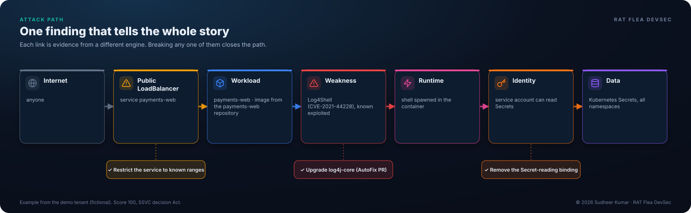
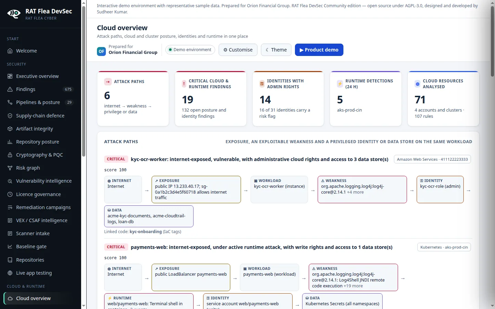

# Attack paths

{ .nm-diagram }

An attack path is reported only when one workload has all three:

-   :material-web:{ .lg } **Exposure**

    ---

    Reachable from the internet: public IP with an open security group, NSG or firewall rule; public LoadBalancer or
    Ingress; unauthenticated function URL; public web app.

-   :material-bug-outline:{ .lg } **Weakness**

    ---

    A critical, high or known-exploited vulnerability in the linked repository or image, a serious misconfiguration of
    the workload itself, or a runtime detection on it.

-   :material-key-chain:{ .lg } **Impact**

    ---

    Its identity holds administrative rights, or can reach a data store: storage, databases, key vaults or Kubernetes
    Secrets, including across accounts through workload identity.

Paths are stored as findings (`NM-PATH-001`), so they are scored, ticketed, gated and reported like everything else,
and they close automatically when any link is broken. The steps show which link is cheapest to break: close the
exposure, fix the code (often with an AutoFix pull request), or reduce the identity's rights.

{ .nm-shot }

## How workloads are linked to code

| Link | Example |
|---|---|
| IaC tags written by your pipeline | `git_repo`, `git_file`, `git_commit` on a bucket, VM or cluster |
| Kubernetes annotation | `myelin.io/repo: payments-gateway` on a Deployment |
| Image name | `acmeprod.azurecr.io/payments-web:2026.11.3` → repository `payments-web` |

Each link is shown with the evidence it came from, so an analyst can confirm it. Exposure is computed from the network
rules the collectors can see; controls outside the account (an external WAF or proxy) are not known, so confirm a path
before treating it as exploitable.
