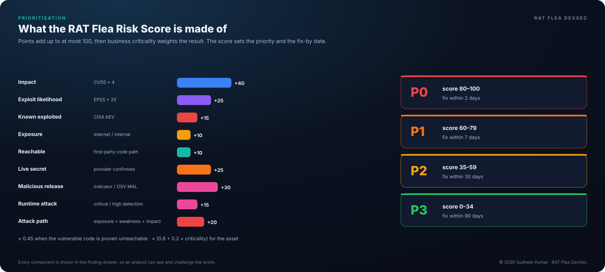

# NERvvE Risk Score

{ .nm-diagram }

Severity alone over-alerts: a critical rule in a test fixture matters less than a high one that is exploited in the
wild and reachable from an internet-facing service. The NERvvE Risk Score (MRS) ranks by how an attacker would use
the finding.

| Component | Points | Source |
|---|---|---|
| Impact | CVSS × 4 (up to 40); a severity default when there is no CVSS | advisory or rule |
| Exploit likelihood | EPSS × 25; code and configuration findings use a severity-based prior | FIRST EPSS |
| Known exploited | +15 | CISA KEV |
| Exposure | +10 internet, +4 internal | repository or resource exposure |
| Reachable | +10 when first-party code reaches it; × 0.45 when proven unreachable | import graph |
| Live secret | +25 when the issuing provider confirms it (opt-in); +10 for a provider-format key | secret validation |
| Malicious release | +30 | indicator pack, OSV malicious-package advisories |
| Runtime attack | +15 for a critical or high detection | Falco, Tetragon |
| Attack path | +20 | exposure + weakness + impact on one workload |
| Business criticality | × (0.8 + 0.2 × criticality) | repository or asset setting |

The score is capped at 100 and sets the priority: **P0** 80–100 (fix in 2 days), **P1** 60–79 (7 days), **P2** 35–59
(30 days), **P3** below 35 (90 days).

## CISA SSVC

Every finding also carries a CISA Stakeholder-Specific Vulnerability Categorization decision:

| Decision point | How it is derived |
|---|---|
| Exploitation | *active*: KEV, provider-confirmed live secret, malicious release, critical/high runtime detection, or an attack path through a known-exploited weakness or runtime detection · *poc*: EPSS ≥ 10 %, confirmed by live testing, any runtime detection or attack path · otherwise *none* |
| Automatable | internet-exposed and reachable (dependencies, live testing, supply chain, cloud posture, attack paths), a live secret or a malicious package |
| Technical impact | *total* for code execution, injection, authentication bypass and credential classes or critical severity; *partial* otherwise |
| Mission and well-being | from the repository's business criticality |

The decision (Track, Track\*, Attend, Act) and its inputs are shown in the finding drawer and recomputed when
intelligence changes.
