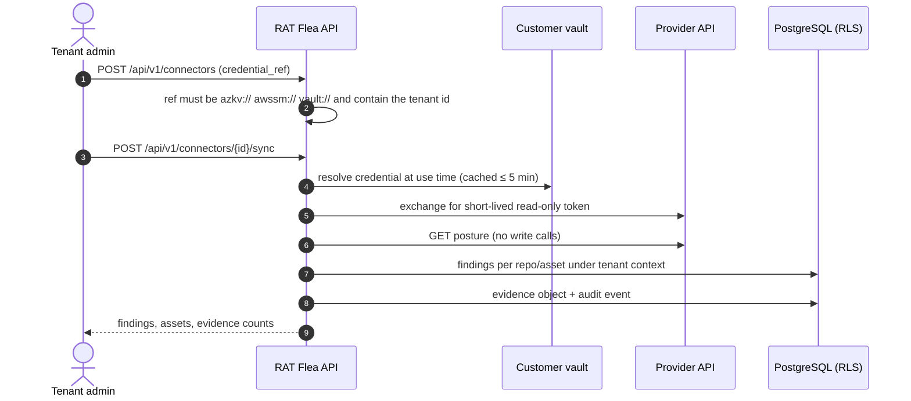

# RAT Flea DevSec — Connectors

*NM-ARC-001 · Enterprise Architecture & Deployment Pack · Version 1.1 · 13 November 2026 · Customer confidential*

## 6. Connector framework and least privilege

Connectors pull posture data from the customer's platforms into tenant findings and evidence. Every connector is read-only, uses short-lived credentials, and holds no secret in the RAT Flea database.

**Connector sync** ([PNG](diagrams/08-connector-sync.png))

| Connector | Identity | Permissions granted | Collected |
|---|---|---|---|
| GitHub | GitHub App installed on selected repositories; installation token (1 h) requested with explicit read permissions | Metadata, Contents, Actions, Administration, Code scanning alerts: read. Template: config/connectors/github-app-manifest.json | Workflow posture (CI/CD rules incl. unprotected default branch), pipeline definitions as evidence |
| Azure | Workload identity federation (preferred) or service principal | Custom role 'RAT Flea DevSec Reader' with read actions only. Template: config/connectors/azure-role-definition.json | Defender for Cloud assessments, ACR (admin user, public access), AKS (local accounts, Azure Policy) |
| AWS | IAM role assumed with sts:AssumeRole and a mandatory ExternalId; 15-minute session | ecr Describe/List and securityhub:GetFindings only. Templates: config/connectors/aws-iam-policy.json, aws-trust-policy.json | ECR scan-on-push and tag mutability, Security Hub findings |

### 6.1 Credential references

- Connector rows store a reference such as vault://secret/myelin/tenants/<tenant-id>/github, never a secret value.
- References must use a vault scheme (azkv, awssm, vault) and include the tenant id. env:// and file:// references, which would expose platform secrets, are rejected for connectors.
- All provider endpoints must be HTTPS. The GitHub connector issues GET requests only.

### 6.2 Adding connectors

A connector is a class that declares its configuration fields and implements test() and sync() returning findings, assets and evidence. Registered connectors appear in /api/v1/connectors/types. Planned connectors follow the same least-privilege pattern (GitLab, Azure DevOps, Jira, ServiceNow, Google Cloud).
