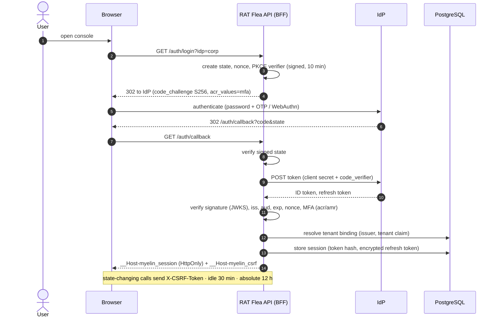

# RAT Flea DevSec — Identity and access

*NM-ARC-001 · Enterprise Architecture & Deployment Pack · Version 1.1 · 13 November 2026 · Customer confidential*

## 4. Identity and access

### 4.1 Console sign-in (OIDC, PKCE, MFA)

The console uses the backend-for-frontend pattern: the browser never holds tokens. The API performs the OpenID Connect authorisation-code flow as a confidential client and issues an opaque, server-side session.

**Console sign-in with MFA step-up** ([PNG](diagrams/06-auth-sequence.png))

### 4.2 Token verification

- Issuer allow-list: only issuers configured in identity-providers.yaml are accepted; keys are fetched from each issuer's discovery document over HTTPS and cached, with refresh on an unknown key id.
- Algorithm allow-list: RS256/384/512, PS256/384/512, ES256/384/512, EdDSA. alg=none and HMAC algorithms are rejected (prevents key-confusion attacks).
- Claims: signature, iss, aud (and azp when present), exp, nbf, iat with 60-second leeway and a maximum token age.
- MFA: required by default. Satisfied by an acr value or amr method the provider preset recognises. Otherwise the API answers 401 with WWW-Authenticate: Bearer error="insufficient_user_authentication", acr_values="mfa" (RFC 9470), so clients can re-authenticate with MFA.
- Tenant: read from the provider's tenant claim and mapped through a server-side (issuer, value) binding. A token from a trusted issuer cannot select an arbitrary tenant, and headers or query parameters are never consulted.

### 4.3 Supported identity providers

| Provider | Preset | Tenant claim | Roles from | MFA signal |
|---|---|---|---|---|
| Keycloak (bundled) | keycloak | tenant | realm_access.roles, client roles | acr mfa / amr otp, webauthn |
| Microsoft Entra ID | entra | tid | roles (app roles) | amr mfa (Conditional Access) |
| Okta | okta | myelin_tenant | groups | acr 2FA / amr mfa, otp, hwk |
| Auth0 | auth0 | namespaced claim | namespaced roles claim | acr multi-factor / amr mfa |
| PingFederate / PingOne | ping | myelin_tenant | groups | acr MFA / amr mfa, otp |
| Google Workspace | google | hd | groups | amr mfa |
| Any OIDC provider | generic | configurable | configurable | configurable acr / amr |
| SAML 2.0 IdPs (ADFS, Shibboleth, etc.) | keycloak | via brokering | mapped in Keycloak | per IdP policy |

Every preset value can be overridden per provider. Several providers can be active at once, for example Entra ID for employees and Keycloak for contractors, each bound to its tenant.

### 4.4 Roles and permissions

| Permission | viewer | developer | auditor | security_lead | tenant_admin | integration |
|---|---|---|---|---|---|---|
| findings:read | ✓ | ✓ | ✓ | ✓ | ✓ | ✓ |
| findings:fix |  | ✓ |  | ✓ | ✓ |  |
| findings:triage |  |  |  | ✓ | ✓ |  |
| scans:write / scans:run |  |  |  | ✓ | ✓ | write |
| policies:read | ✓ | ✓ | ✓ | ✓ | ✓ |  |
| policies:write |  |  |  | ✓ | ✓ |  |
| connectors:read |  |  | ✓ | ✓ | ✓ |  |
| connectors:manage |  |  |  |  | ✓ |  |
| evidence:read / review |  |  | ✓ | ✓ | ✓ |  |
| evidence:collect |  |  |  | ✓ | ✓ | ✓ |
| audit:read |  |  | ✓ | ✓ | ✓ |  |
| users / apikeys / settings:manage |  |  |  |  | ✓ |  |

IdP roles or groups are mapped to RAT Flea roles in configuration; unknown roles grant nothing. Permissions are checked on every route.

### 4.5 API keys for pipelines and integrations

- Format nm_<id>_<secret>; only an HMAC-SHA256 of the secret (with a server-side pepper) is stored.
- Issued per tenant by a tenant administrator (POST /api/v1/api-keys), default expiry 90 days, revocable, last-used time recorded.
- Cannot carry the tenant_admin role; CI keys use the narrow integration role (upload scans, collect evidence, read findings).

### 4.6 Sessions

| Control | Setting |
|---|---|
| Cookie | __Host-myelin_session: HttpOnly, Secure, SameSite=Lax, Path=/, no Domain |
| CSRF | Double-submit token (__Host-myelin_csrf + X-CSRF-Token header) on every state-changing request |
| Storage | Server side; only a SHA-256 of the session token is stored; refresh token AES-256-GCM encrypted with the tenant id as associated data |
| Lifetime | Idle 30 minutes, absolute 12 hours (configurable); logout revokes server side |
| Open redirect | return_to accepts only same-origin relative paths |
