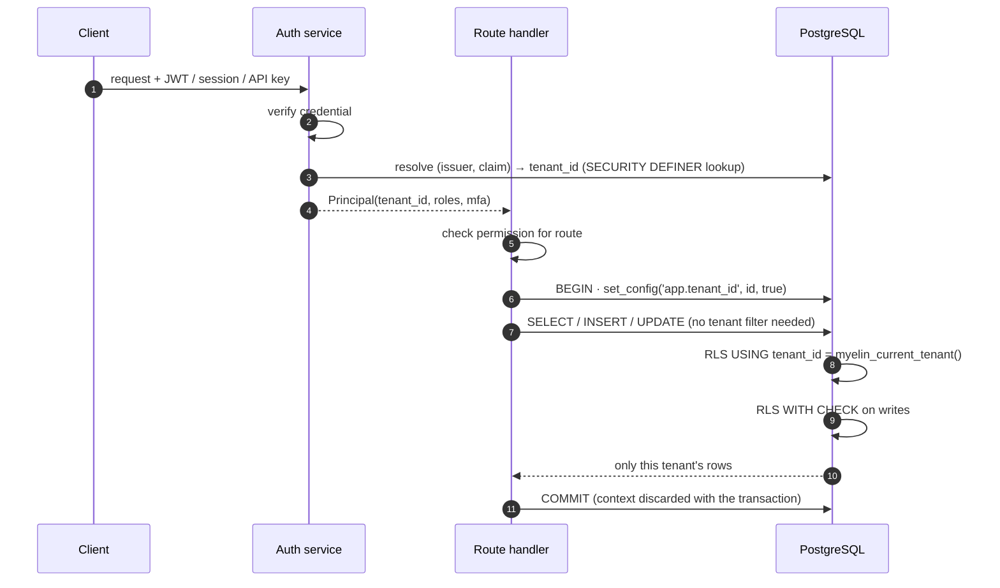

# NERVE Myelin — Multi-tenancy

*NM-ARC-001 · Enterprise Architecture & Deployment Pack · Version 1.1 · 13 November 2026 · Customer confidential*

## 5. Multi-tenancy and data isolation

Isolation is enforced by the database, so a missing filter in application code cannot expose another tenant's data. The application connects as a role that cannot bypass row-level security, and every transaction declares its tenant from the verified Principal.

**Request-scoped tenant isolation** ([PNG](diagrams/07-tenant-isolation.png))



### 5.1 Database roles

| Role | Login | Purpose and limits |
|---|---|---|
| owner (myelin_owner) | yes | Owns the schema; used only by migrations and the admin CLI. Subject to FORCE RLS like everyone else. |
| myelin_app | no | NOBYPASSRLS group role granted to the API login. CRUD on operational tables; SELECT/INSERT only on evidence and audit; no DDL; cannot SET ROLE. |
| API login (myelin_api) | yes | Member of myelin_app. The admin CLI refuses to grant myelin_app to a SUPERUSER or BYPASSRLS login. |
| myelin_auth | no | Owns two SECURITY DEFINER functions that map an API-key id or session hash to a tenant before tenant context exists. Column-level SELECT only. |
| myelin_admin | no | Platform operations across tenants (provisioning, retention purge, backups) through explicit admin policies. |

### 5.2 Policies

```
-- every tenant table
ALTER TABLE findings ENABLE ROW LEVEL SECURITY;
ALTER TABLE findings FORCE ROW LEVEL SECURITY;
CREATE POLICY tenant_isolation ON findings
  USING (tenant_id = myelin_current_tenant())
  WITH CHECK (tenant_id = myelin_current_tenant());

-- fails closed: no or malformed context -> NULL -> no rows match
CREATE FUNCTION myelin_current_tenant() RETURNS uuid STABLE LANGUAGE sql AS
$$ SELECT NULLIF(current_setting('app.tenant_id', true), '')::uuid $$;
```

The tenant context is set with set_config(..., true), which is transaction-local, so it cannot leak to the next request that reuses a pooled connection.

### 5.3 Isolation verification

The following tests run against a real PostgreSQL 16 instance in CI (backend/tests/test_tenant_isolation.py and test_enterprise.py):

| Test | Expected result |
|---|---|
| Read with tenant A context | Only tenant A rows |
| Fetch tenant B object id with tenant A context (API and SQL) | Not found (404) / zero rows |
| No tenant context on every table | Zero rows |
| Insert or move a row into another tenant | Rejected by WITH CHECK |
| Update or delete another tenant's rows | Zero rows affected |
| Pooled connection reuse after a request | Context does not persist |
| Non-UUID tenant value | Rejected |
| App role: disable RLS, drop policy, SET ROLE, session_replication_role, insert bindings | Permission denied |
| X-Tenant-Id header or ?tenant= spoofing through the API | No effect |
| Audit log UPDATE/DELETE, evidence DELETE within retention | Rejected even for the admin role |
| Backup restored into a new database | RLS still forced on all 12 tables; audit chain verifies |
