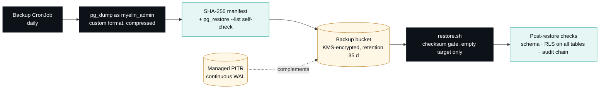

# NERvvE DevSecOps — Operations

*NM-ARC-001 · Enterprise Architecture & Deployment Pack · Version 1.1 · 13 November 2026 · Customer confidential*

## 8. Production operations

### 8.1 Prerequisites

| Item | Requirement |
|---|---|
| Kubernetes | 1.27+ with ingress-nginx (or equivalent), cert-manager, External Secrets Operator; Prometheus Operator recommended |
| PostgreSQL | 16.x managed service (Azure Database for PostgreSQL Flexible Server, Amazon RDS/Aurora, Cloud SQL) with TLS, private networking and point-in-time recovery |
| Object storage | S3 bucket or Azure storage account for reports, evidence and backups |
| Identity provider | OIDC confidential client with redirect URI https://<host>/auth/callback, MFA policy, tenant claim and role or group claims |
| Vault | Azure Key Vault, AWS Secrets Manager or HashiCorp Vault for platform and connector secrets |

### 8.2 Deployment

```
# 1. Database logins (DBA): owner for migrations, least-privilege login for the API
CREATE ROLE myelin_owner LOGIN CREATEROLE PASSWORD '...';
CREATE ROLE myelin_api   LOGIN NOBYPASSRLS PASSWORD '...';
CREATE DATABASE myelin OWNER myelin_owner;

# 2. Secrets in the vault (names in values.yaml -> secrets.keys)
scripts/ops/gen-secrets.sh   # generates session secret, API-key pepper, Ed25519 signing key

# 3. Install (migration hook runs first, then API pods)
helm upgrade --install myelin deploy/helm/myelin -n nerve-myelin --create-namespace \
     -f config/deploy/values-customer.example.yaml

# 4. Attach the API login to the RLS-bound role, create the first tenant
kubectl -n nerve-myelin run admin --rm -it --image=<image> -- admin grant-app-login --login myelin_api
kubectl -n nerve-myelin run admin --rm -it --image=<image> -- admin tenant-create \
     --slug acme --name "Acme Bank" --plan enterprise --bind https://login.microsoftonline.com/<tid>/v2.0=<tid>
```

### 8.3 Configuration reference

| Setting | Purpose |
|---|---|
| MYELIN_MODE | enterprise (PostgreSQL, OIDC, RLS) or demo |
| MYELIN_DATABASE_URL | API connection (least-privilege login); may be a secret reference |
| MYELIN_MIGRATIONS_DATABASE_URL | Owner connection for migrate/admin only |
| MYELIN_IDP_CONFIG | Path to identity-providers.yaml (mounted from a ConfigMap) |
| MYELIN_SESSION_SECRET_REF / _API_KEY_PEPPER_REF | Secret references: env://, file://, azkv://, awssm://, vault:// |
| MYELIN_EVIDENCE_STORE | s3://bucket/prefix?region=…, azblob://account/container/prefix or file:///path |
| MYELIN_PUBLIC_URL | External URL; used for OIDC redirect URIs and CORS |
| MYELIN_SESSION_IDLE_MINUTES / _ABSOLUTE_HOURS | Session lifetime (30 / 12) |
| MYELIN_TRUSTED_PROXIES | CIDRs whose X-Forwarded-* headers are trusted |

### 8.4 Health, monitoring and alerting

| Endpoint / signal | Use |
|---|---|
| /healthz | Liveness and startup probe (process alive) |
| /readyz | Readiness: database reachable and schema version reported; 503 when not ready |
| /metrics | Prometheus: myelin_http_requests_total, myelin_http_request_seconds, myelin_auth_failures_total |
| Alerts | API down, 5xx rate > 2%, p95 latency > 1.5 s, authentication-failure spike, object-id enumeration, no backup in 26 h |
| Logs | JSON to stdout with request id, route, status and latency; never tokens, secrets or evidence content |

### 8.5 Backup and restore

**Backup and restore** ([PNG](diagrams/10-backup-restore.png))



- Daily logical backups (pg_dump through the myelin_admin role, because FORCE RLS applies even to the owner) with a SHA-256 manifest, plus the managed database's point-in-time recovery for RPO in minutes.
- restore.sh refuses a checksum mismatch or a non-empty target, restores in a single transaction, then reports schema version, RLS-protected tables and tenant count.
- After restore, run myelin admin verify-audit --tenant <slug> for each tenant: the hash chain must verify.
- Evidence objects are not in the database dump; they remain in object storage and are re-verified by hash on access.
- Recommended targets: RPO ≤ 15 minutes (PITR), RTO ≤ 4 hours; restore drills quarterly.

### 8.6 Upgrades and rollback

- helm upgrade runs the migration Job first (pre-upgrade hook); API pods roll only after it succeeds. Migrations are forward-only and backward-compatible for one release.
- Rollback: helm rollback to the previous revision; restore from backup only if a migration must be reversed.
- Images are referenced by digest; verify the NERvvE DevSecOps cosign signature with your admission controller.

### 8.7 Hardened container and release pipeline

| Control | Implementation |
|---|---|
| Minimal runtime | Multi-stage build; compilers and pip only in the build stage; no package manager in the runtime virtualenv; OS packages upgraded at build |
| Least privilege | UID/GID 10001, read-only root filesystem, all capabilities dropped, no privilege escalation, seccomp RuntimeDefault |
| Immutable application files | Application tree owned by root and not writable by the runtime user; tests removed from the image |
| CI security gates | Unit and isolation tests against PostgreSQL, NERvvE DevSecOps self-scan policy gate, pip-audit, gitleaks, Trivy (fixable critical/high fail the build), hadolint, Helm lint and schema validation |
| Supply chain | All CI actions pinned to commit SHAs; BuildKit provenance; CycloneDX SBOM; keyless cosign signature and CycloneDX SBOM |

### 8.8 Single-host evaluation stack

```
scripts/ops/gen-secrets.sh > config/backend/enterprise.env
docker compose -f docker-compose.enterprise.yml --env-file config/backend/enterprise.env up -d
# console  https://myelin.localtest.me:8443    Keycloak  https://auth.localtest.me:8444
# realm 'myelin' ships test users for tenants acme and globex; TOTP enrolment is required at first sign-in
docker compose -f docker-compose.enterprise.yml exec myelin-api myelin admin tenant-create \
  --slug acme --name "Acme Bank" --plan enterprise --bind https://auth.localtest.me:8444/realms/myelin=acme
```
