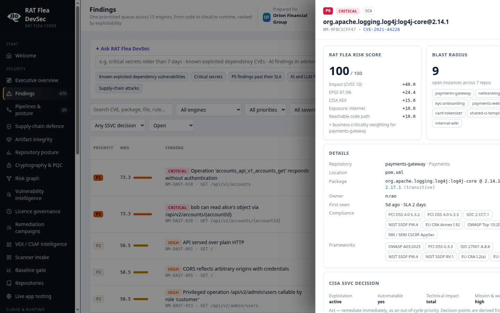
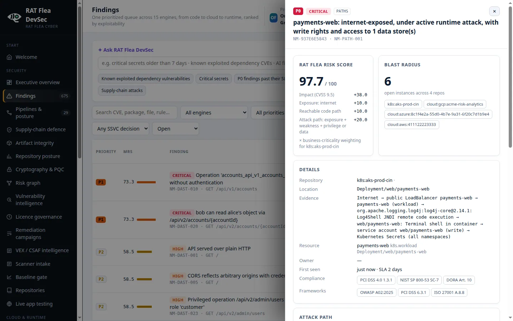
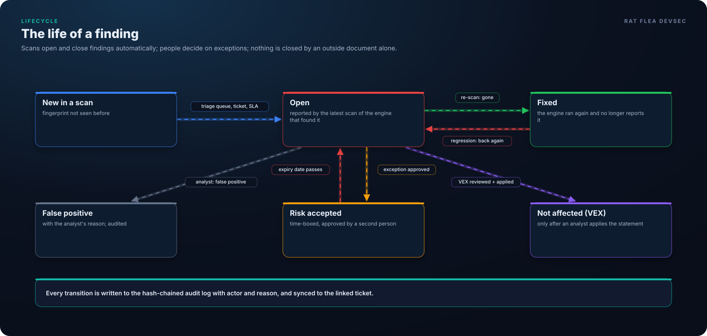

# Anatomy of a finding

{ .nm-shot }

A finding is one weakness at one location. Every engine and every imported scanner produces the same record.

## Identity

| Field | Meaning |
|---|---|
| **ID** | `NM-` plus the first characters of the fingerprint; stable across scans |
| **Fingerprint** | Hash of engine, rule, CVE, package, file, line and repository. The same weakness reported by two engines or two scans is one finding |
| **Engine** and **rule** | Which engine found it and which rule (`NM-SAST-001`, `CVE-2021-44228`, `NM-AZ-012` …) |

## Where

| Field | Meaning |
|---|---|
| **Repository** | The code repository, cloud account, cluster or application |
| **Location** | File and line (with a link to the source at the scanned commit), package and version, cloud resource ID, or URL and parameter |
| **Created by code** | For cloud and cluster findings: the repository, IaC file and commit that created the resource |
| **Resource** | Cloud or Kubernetes resource name, type and region |

## How serious

| Field | Meaning |
|---|---|
| **Severity** | From the rule or the scanner (critical, high, medium, low, info) |
| **Myelin Risk Score** | 0–100; every component is listed in the drawer ([how it is computed](../concepts/risk-score.md)) |
| **Priority and SLA** | P0 (2 days) · P1 (7) · P2 (30) · P3 (90), from the score |
| **CISA SSVC** | Track, Track\*, Attend or Act, with the four decision points |
| **Exploitation signals** | EPSS, CISA KEV, reachability, exposure, live secret, malicious release, runtime detection |
| **Frameworks** | OWASP, CWE Top 25, PCI DSS, ISO 27001, NIST, SOC 2, CIS, EU CRA, MITRE ATT&CK references |

## What to do

| Field | Meaning |
|---|---|
| **Remediation** | The fix in plain words; AutoFix opens a pull request when a safe mechanical fix exists |
| **Evidence** | What the engine saw (secrets are redacted) |
| **Attack path** | For `NM-PATH-001`: every step from the internet to the identity or data, see below |
| **Status and triage** | Open, fixed, risk accepted (with expiry and approver), false positive or not affected (VEX), with the reason |
| **Ticket** | The linked Jira, ServiceNow or Azure Boards item |

{ .nm-shot }

## Lifecycle

{ .nm-diagram }

- A finding opens when an engine reports a fingerprint for the first time, and **closes as fixed only when the same
  engine ran again** on the same repository and no longer reports it. A regression reopens it.
- Risk acceptance is time-boxed and approved by a second person; when it expires the finding is open again.
- A VEX statement never closes a finding by itself: an analyst reviews the exact matches and applies them.
- Every change is recorded in the audit log with actor and reason and synchronised to the linked ticket.
