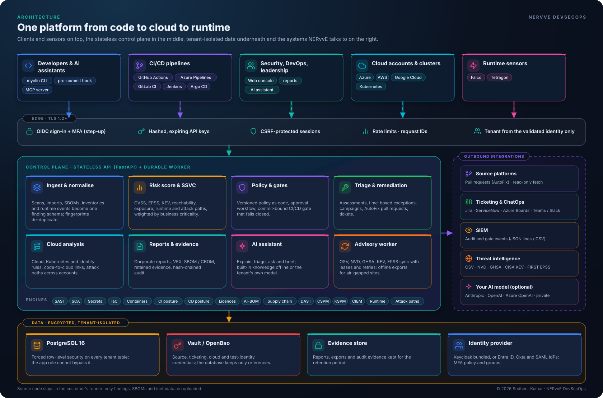

# Architecture

{ .nm-diagram }

[:material-cursor-default-click-outline: Open the interactive architecture explorer](../assets/explorer/index.html){ .md-button .md-button--primary target="_blank" }
:material-download: Download the poster (PNG){ .md-button }

## Building blocks

-   :material-console:{ .lg } **Clients**

    ---

    The `myelin` CLI in CI runners and on workstations, the pre-commit hook, the MCP server for AI coding assistants,
    and the web console. Cloud collectors and runtime sensors send configuration and detections.

-   :material-api:{ .lg } **API (stateless)**

    ---

    FastAPI service behind TLS ingress. Authenticates every call (OIDC session or API key), resolves the tenant from
    the identity only, checks the role's permission, and serves the console. Scales horizontally.

-   :material-cog-sync-outline:{ .lg } **Worker**

    ---

    Durable background jobs: advisory synchronisation (OSV, NVD, GHSA, KEV, EPSS) with leases, retries and a tenant
    allowlist; a bounded scan queue for repository scans.

-   :material-magnify-scan:{ .lg } **Engines**

    ---

    One Python package shared by the CLI and the API: SAST, SCA, secrets, IaC, CI and CD posture, licences, AI
    security, supply chain, DAST, cloud, Kubernetes and identity rules, attack-path graph.

-   :material-database-lock-outline:{ .lg } **Data**

    ---

    PostgreSQL 16 with forced row-level security on every tenant table; Vault / OpenBao for credentials;
    hash-chained audit log.

-   :material-connection:{ .lg } **Integrations**

    ---

    Source platforms, ticketing, ChatOps, SIEM, identity providers, intelligence feeds and an optional AI model.
    Every credential is a vault reference.

## Technology

| Layer | Technology |
|---|---|
| Console | One self-contained page (HTML, CSS, JavaScript); no external fonts, scripts or trackers |
| API | Python 3.12, FastAPI, Pydantic, Uvicorn |
| Engines | Python; optional bundled scanners in the CLI image (Trivy, Gitleaks, Checkov, Bandit, Cosign) |
| Database | PostgreSQL 16, SQLAlchemy 2, Alembic migrations |
| Identity | OIDC (Keycloak bundled; Entra ID, Okta and others), MFA with step-up |
| Secrets | OpenBao / HashiCorp Vault, Azure Key Vault, AWS Secrets Manager references |
| Packaging | Hardened non-root container images, Helm chart, Docker Compose |

## Deployment

!Deployment

More detail: enterprise architecture pack, [operations](../enterprise/OPERATIONS.md),
[multi-tenancy](../enterprise/MULTI-TENANCY.md).
