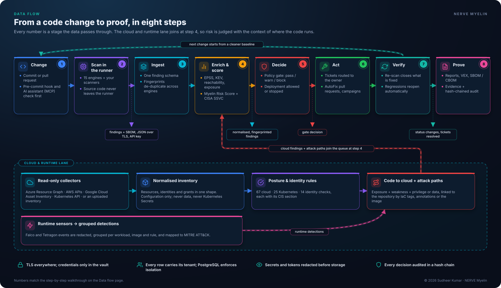
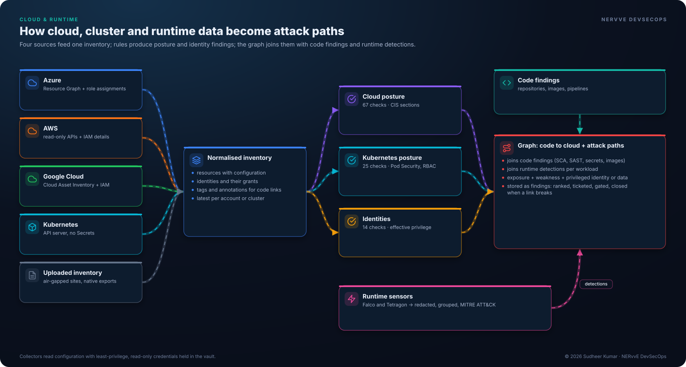

# Data flow

{ .nm-diagram }

Follow one change through the platform. The numbers match the diagram.

1.  **Change.** A developer commits or opens a pull request. The pre-commit hook and the MCP server let the developer
    and their AI assistant check code before it is pushed.
2.  **Scan in the runner.** `myelin scan` runs the engines inside your CI runner, plus any scanners you already use.
    *Source code never leaves the runner.*
3.  **Ingest.** Findings and the SBOM are uploaded as JSON over TLS with an integration API key. Every result becomes
    one finding record; a fingerprint (engine, rule, location, package, repository) removes duplicates across engines.
4.  **Enrich and score.** Exploit probability (EPSS), known exploitation (CISA KEV), reachability, exposure, runtime
    evidence and attack paths are combined into the [NERvvE Risk Score](../concepts/risk-score.md) and a CISA SSVC
    decision. Cloud and runtime findings join here.
5.  **Decide.** The policy bound to the repository returns pass, warn or block. The decision is recorded
    against the exact commit, so a deployment can be stopped before it reaches production.
6.  **Act.** Tickets are created for the owning team, AutoFix opens pull requests, campaigns group related work.
7.  **Verify.** The next scan by the same engine closes what is fixed and reopens regressions; tickets follow.
8.  **Prove.** Reports, VEX, SBOM / CBOM, evidence and the hash-chained audit log show auditors and customers
    what was checked and decided.

## Cloud and runtime lane

{ .nm-diagram }

Read-only collectors (or an uploaded inventory) produce one normalised inventory per account or cluster. Posture and
identity rules run on it, and the graph joins the results with code findings and runtime detections to find
[attack paths](../concepts/attack-paths.md). See [Cloud security](../CLOUD-SECURITY.md).

## What is sent where

| Flow | Content | Protection |
|---|---|---|
| Runner → platform | findings, SBOM, gate requests | TLS, hashed and expiring API key, tenant from the key |
| Browser → platform | console use | OIDC with MFA, server-side session, CSRF token |
| Cloud / cluster → platform | configuration (no data, no Kubernetes Secrets) | read-only roles, credentials in the vault |
| Runtime sensor → platform | detections (tokens redacted) | TLS, integration API key |
| Platform → ticketing / SCM | ticket text, pull requests | scoped tokens from the vault |
| Platform → intelligence feeds | package and CVE identifiers only | TLS; no tenant data |

The full boundary view is on the [Security architecture](../security/architecture.md) page; the detailed data-flow
diagram of the enterprise pack is here.
