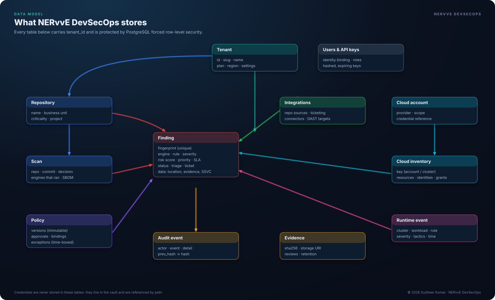

# Data model

{ .nm-diagram }

Every entity belongs to exactly one tenant. The tenant comes from the validated identity of the caller and PostgreSQL
enforces it on every statement (forced row-level security; the application role cannot bypass it).

| Entity | What it is | Key fields |
|---|---|---|
| **Tenant** | An organisation using the platform | slug, name, plan, region, settings |
| **User, API key** | People (from the identity provider) and machine credentials | identity binding, roles; key hash, expiry |
| **Repository** | A code repository, cloud account (`cloud:<provider>:<account>`), cluster (`k8s:<name>`) or tested application | name, business unit, criticality, project |
| **Scan** | One run of one or more engines against a repository | commit, decision, engines that ran, SBOM, fingerprints |
| **Finding** | One weakness at one location | fingerprint (unique per tenant), engine, rule, severity, risk score, priority, status, triage, ticket, evidence |
| **Policy** | Versioned policy documents and where they apply | immutable versions, approvals, bindings, exceptions |
| **Integrations** | Repository sources, ticketing, connectors, live-testing targets | configuration, credential reference |
| **Cloud account** | A subscription, account, project or cluster collected read-only | provider, scope, credential reference |
| **Cloud inventory** | Latest normalised configuration of one account or cluster | resources, identities, grants, summary |
| **Runtime event** | One detection from a runtime sensor | cluster, workload, rule, severity, tactics, time |
| **Evidence** | A stored report or export with its hash, reviews and retention | sha256, storage URI, retention |
| **Audit event** | Every security-relevant action | actor, event, detail, previous hash, hash |

!!! info "Repositories are a general container"
    Cloud accounts, clusters and live applications are stored as repositories so the same policy, gate, ticketing,
    reporting and dashboards work for them without special cases.

!!! success "What is never stored"
    Credentials (vault references only), secret values found by the scanners (redacted), source code, data from
    buckets or databases, and Kubernetes Secrets.

Next: [Anatomy of a finding](anatomy-of-a-finding.md).
