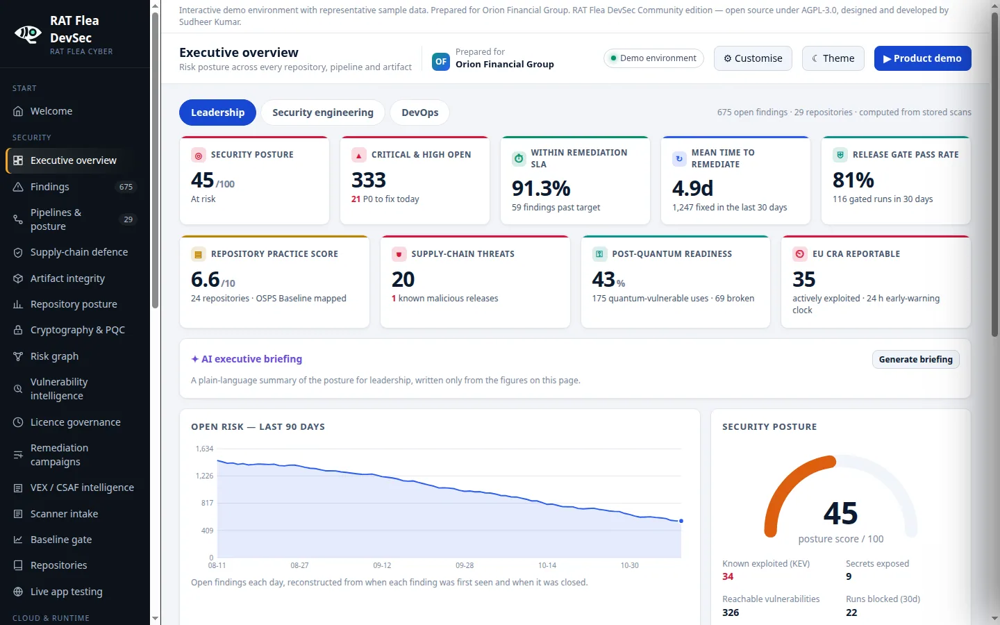

# Features

{ .nm-shot }

Everything below ships in the current release and is covered by automated tests
(release evidence).

## Find

| Engine | Covers |
|---|---|
| Code (SAST) | Data-flow (taint) analysis with Opengrep and the NERvvE rule pack (78 rules) for Python, JavaScript/TypeScript, Java, Go, C#, PHP and Ruby; 40 pattern rules (also Kotlin); Bandit for Python. See [how scanning works](../concepts/scanning.md) |
| Open source (SCA) | npm, PyPI, Maven, Go, Rust, PHP, Ruby, Gradle and .NET from manifests and lockfiles; OSV / PyPI intelligence plus Trivy and Grype; import-level reachability; fix versions |
| Secrets | 15 provider formats plus Gitleaks and Trivy (git history when the repository is cloned with git); opt-in confirmation with the issuing provider |
| Infrastructure as Code | Dockerfile, Compose, Kubernetes, Helm, Terraform, Bicep (29 rules + Checkov + Trivy) |
| Containers | Image OS and language packages (Trivy / Grype) |
| CI and CD posture | GitHub Actions, Azure Pipelines, GitLab CI, Argo CD, Flux, Helm, Tekton, cloud build services |
| Supply-chain defence | Malicious and look-alike packages, AI-hallucinated names, worms, dependency confusion, cooldown |
| AI application security | LLM, agent, RAG and MCP risks; AI coding-agent rule files |
| Live application testing | Read-only checks, crawler, multi-user authorisation tests, authorised active checks; OWASP ZAP spider, passive and (authorised) active scanning |
| Cloud posture | Azure, AWS, Google Cloud (67 checks) |
| Kubernetes posture | Pod Security Standards, RBAC, exposure, isolation (25 checks) |
| Identities | Effective privilege, MFA, keys, dormant, external and public access (14 checks) |
| Runtime | Falco and Tetragon detections, MITRE ATT&CK |
| Attack paths | Exposure + weakness + privileged identity or data |
| Your scanners | SARIF, CycloneDX, Trivy, Grype, Semgrep, Gitleaks, Checkov, Bandit, ZAP |

## Decide

- [NERvvE Risk Score](../concepts/risk-score.md) and CISA SSVC on every finding
- [Policy as code](../POLICY-GOVERNANCE.md): versioned, four-eyes approval, bindings, time-boxed exceptions
- [Commit-bound CI/CD gate](../CD-PIPELINE-SECURITY.md) that fails closed, deployment checks

## Act

- [AutoFix pull requests](../DEVELOPER-TOOLS.md) on GitHub, GitLab and Azure DevOps
- [Ticketing](../TICKETING.md): Jira, ServiceNow, Azure Boards, Teams / Slack, routed by owner, auto-resolved
- Remediation campaigns with approval and verification; [AI assistant](../AI-FEATURES.md) for explain, triage, ask and briefing
- Developer tools: pre-commit hook and MCP server for AI coding assistants

## Prove

- [Corporate assessment reports](../ASSESSMENT-REPORTS.md), internal and customer-publishable editions
- SBOM, CBOM, [VEX / CSAF](../VEX-LIFECYCLE.md); EU CRA tracker; OSPS Baseline posture
- Retained audit evidence and a hash-chained audit log

## Run anywhere

Multi-tenant SaaS, dedicated single-tenant, self-hosted (Docker Compose, Helm) and air-gapped, with OIDC single
sign-on, MFA, seven roles and PostgreSQL row-level security per tenant.
