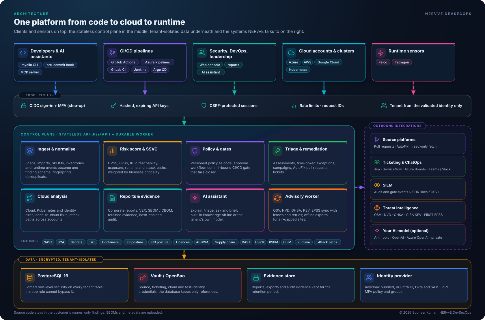

NERvvE DevSecOps and cloud-native application protection

# Secure the code, the pipeline, the cloud and the workload, with one policy

One finding queue for fifteen engines, from a developer's commit to a running container. Every result is ranked by how
an attacker would actually use it, gated by one policy, routed to its owner and proven to auditors.

[Get started](getting-started/quick-start.md){ .md-button .md-button--primary } [Evaluate it](getting-started/evaluate.md){ .md-button }
[Architecture](getting-started/architecture.md){ .md-button }
[Data flow](getting-started/data-flow.md){ .md-button }

{ .nm-diagram }

## Where do you want to start?

-   :material-rocket-launch-outline:{ .lg .middle } **Get started**

    ---

    Run the demo in a minute, install the enterprise stack, connect your first repository.

    [:octicons-arrow-right-24: Quick start](getting-started/quick-start.md)

-   :material-sitemap-outline:{ .lg .middle } **Understand the platform**

    ---

    Components, how data moves, what is stored and how a finding is built.

    [:octicons-arrow-right-24: Architecture](getting-started/architecture.md)

-   :material-source-branch:{ .lg .middle } **Secure the pipeline**

    ---

    Scan repositories, gate CI and CD, sign artifacts and enforce at Kubernetes admission.

    [:octicons-arrow-right-24: Scan a repository](SCAN-A-REPOSITORY.md)

-   :material-cloud-lock-outline:{ .lg .middle } **Protect the cloud and runtime**

    ---

    Cloud and Kubernetes posture, identities, runtime detections and attack paths.

    [:octicons-arrow-right-24: Cloud security](CLOUD-SECURITY.md)

-   :material-shield-check-outline:{ .lg .middle } **Security and compliance**

    ---

    Trust boundaries, tenant isolation, evidence integrity and framework mapping.

    [:octicons-arrow-right-24: Security architecture](security/architecture.md)

-   :material-book-open-variant:{ .lg .middle } **Reference**

    ---

    Every rule, API operation, CLI option and setting, generated from the product.

    [:octicons-arrow-right-24: Rules](reference/rules.md)

## What makes it different

**15** engines from code to runtime in one finding schema

**280** built-in rules, every one tested against labelled samples

**1** policy enforced in the IDE, the pipeline, admission and the cloud

**0** lines of source code leave your runner

- **The pipeline is part of the attack surface.** CI and CD definitions are checked against the OWASP Top 10 CI/CD risks, and the gate result is signed onto the image.
- **Prioritisation you can explain.** The NERvvE Risk Score shows every component: impact, EPSS, CISA KEV, reachability, exposure, runtime evidence and attack paths.
- **Code to cloud to runtime.** Cloud, cluster and runtime findings are linked to the repository and file that created them, and attack paths show the one link to break.
- **Proof, not screenshots.** Framework-mapped reports, VEX, SBOM and CBOM, a hash-chained audit log.

!!! note "Documentation conventions"
    Screenshots show the fictional demo tenant *Orion Financial Group*. Figures in them are illustrative. Product
    names of other vendors are trademarks of their owners and are named only to identify compatible products.
