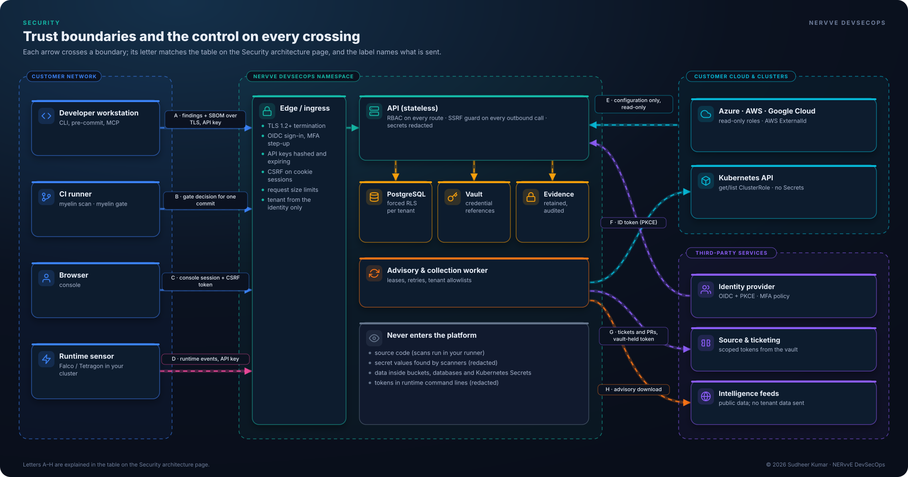

# Security architecture

{ .nm-diagram }

## Data flows across trust boundaries

| Flow | From → to | Content | Controls |
|---|---|---|---|
| **A** | CI runner / workstation → platform | findings, SBOM | TLS 1.2+; integration API key (hashed, expiring, one tenant); request size limits; source code stays in the runner |
| **B** | CI / CD → platform | gate decision for one commit | API key; fails closed when the commit was not scanned or a required engine did not run |
| **C** | Browser → platform | console use | OIDC authorisation code with PKCE; MFA with step-up; server-side session; CSRF token; seven roles |
| **D** | Runtime sensor → platform | detections | API key with the integration role; tokens in command lines redacted before storage |
| **E** | Platform ↔ cloud and clusters | configuration | read-only roles (Azure Reader, AWS SecurityAudit-level with ExternalId, GCP viewer roles, Kubernetes get/list without Secrets); credentials in the vault |
| **F** | Identity provider → platform | ID token | signature, issuer, audience, expiry and nonce checked; issuer bound to one tenant |
| **G** | Platform → ticketing and source platforms | tickets, pull requests | scoped tokens from the vault; SSRF guard; private networks refused unless allowed |
| **H** | Platform → intelligence feeds | package and CVE identifiers | public data only; offline exports for air-gapped sites |

## Controls inside the platform

| Concern | Control |
|---|---|
| Tenant isolation | Tenant from the validated identity only; PostgreSQL forced row-level security on every tenant table; isolation tests run against a real database on every build |
| Authorisation | Permission checked on every route; separation of duties for policy approval, exceptions and evidence signing |
| Secrets | Vault / OpenBao (or Key Vault / Secrets Manager references); the database stores only references; secret values found by scanners are redacted |
| Integrity | Immutable policy versions; evidence hashed with SHA-256; hash-chained audit log |
| Supply chain of the platform | Pinned dependencies, its own SBOM, signed images, self-scan before release |
| Privacy | No external fonts, scripts or trackers in the console; Checkov runs with `--skip-download`; AI providers receive no secrets and no code unless enabled |

Further reading: threat model, [identity](../enterprise/IDENTITY.md),
[multi-tenancy](../enterprise/MULTI-TENANCY.md), evidence integrity,
[vulnerability disclosure](https://github.com/sudheerkumard/nerve-myelin-DevSec/blob/main/SECURITY.md).
