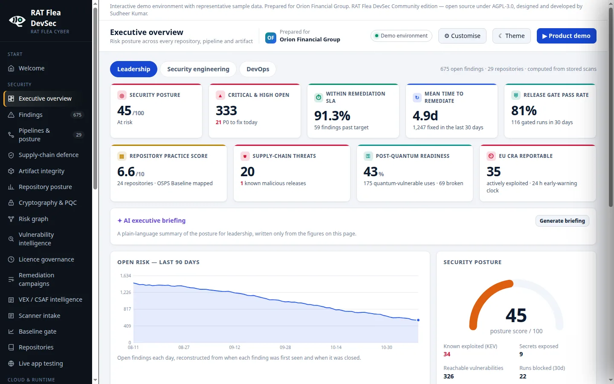
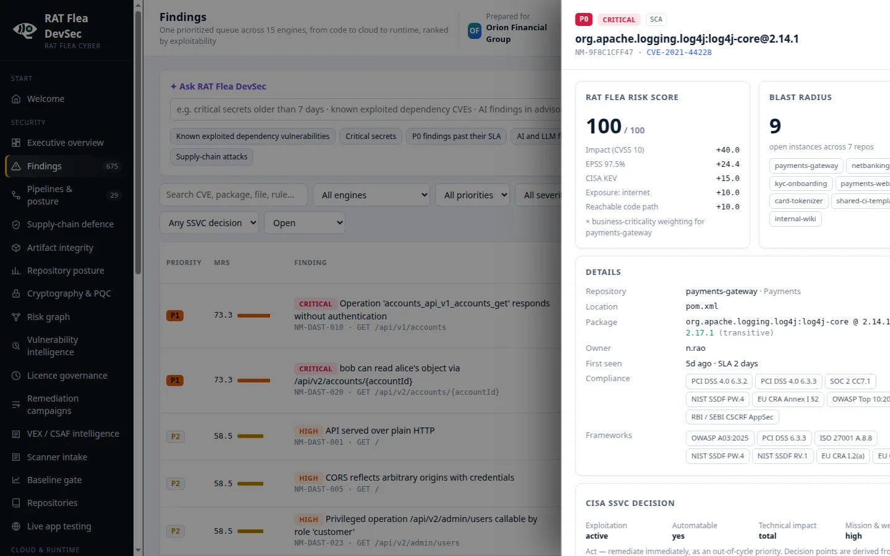
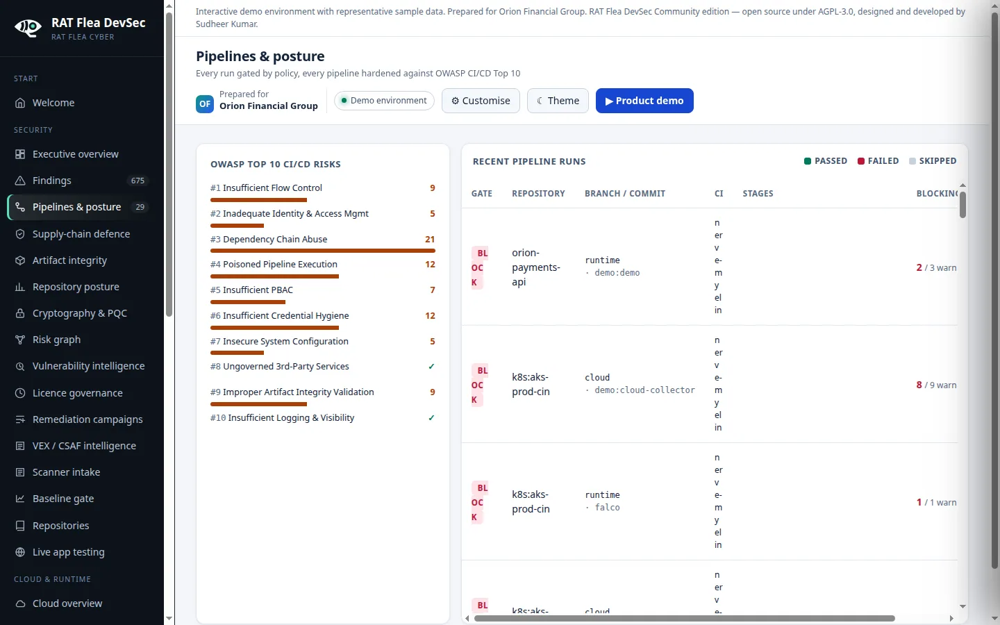
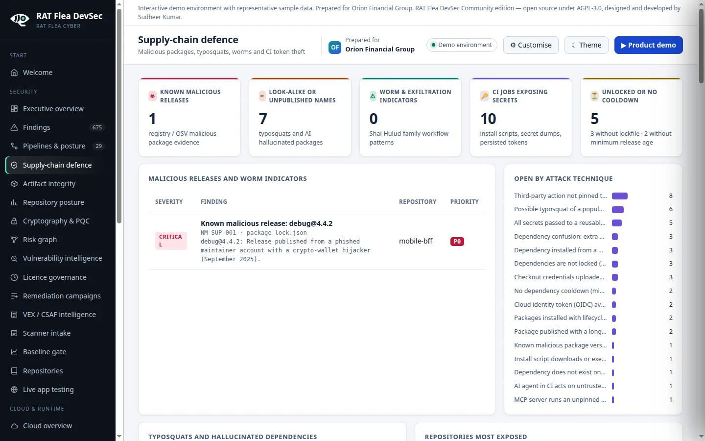
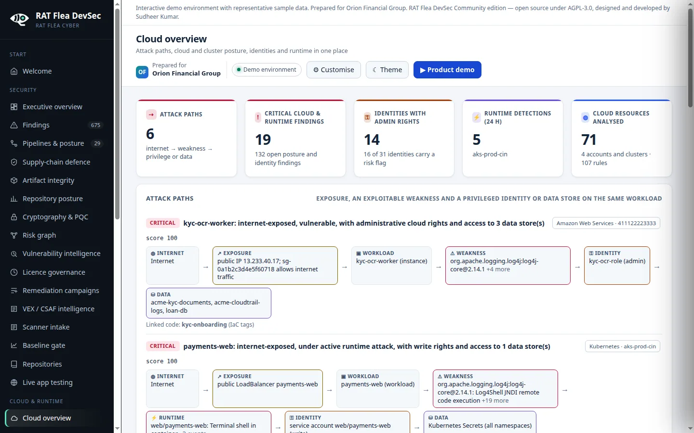
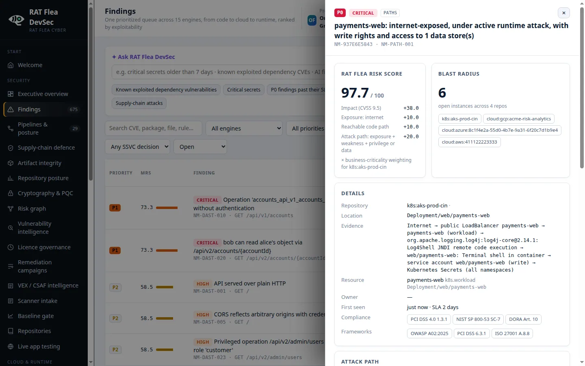

# NERvvE DevSecOps

## Securing the whole software delivery chain: code, dependencies, pipelines, cloud, Kubernetes, runtime and AI

**Whitepaper · Version 1.4 · November 2026**
NERvvE DevSecOps Product designed and developed by Sudheer Kumar · <https://github.com/sudheerkumard/nerve-myelin-DevSec>
Documentation: <https://sudheerkumard.github.io/nerve-myelin-DevSec/> · Designed edition: [open the laid-out whitepaper](designed/index.html)

---

> **For leadership: the five things to know**
>
> 1. **Software delivery is now the front door.** Exploiting a vulnerability has become the most common way into an organisation, and almost half of breaches involve a third party [1].
> 2. **The cost is rising, and so is the personal accountability.** The average breach now costs USD 4.99 million [2], and EU rules make management bodies answerable for cyber risk [4][5].
> 3. **Regulators now have a 24-hour clock.** Since 11 September 2026, actively exploited vulnerabilities in products sold in the EU must be reported within 24 hours [3].
> 4. **Point tools cannot answer the board's question.** Separate scanners give separate numbers; leadership needs one risk score, one policy and one auditable answer to *"are we safer, and can we prove it?"*
> 5. **NERvvE DevSecOps gives that answer.** One platform covers code, pipelines, cloud and runtime. It shows leadership the few risks that matter, blocks unsafe releases automatically, and produces the evidence auditors and regulators ask for.

---

## 1. Executive summary


Software is now attacked through every stage of its delivery, and the numbers have turned it into a board-level
issue. In the 2026 Verizon Data Breach Investigations Report, exploiting a software vulnerability became the most common
way into an organisation for the first time in the report's 19 years, and breaches involving a third party rose to almost
half of the total [1]. The average breach now costs a record USD 4.99 million [2]. And since 11 September 2026, every
manufacturer selling software or connected products in the EU must report actively exploited vulnerabilities within 24
hours [3].

The attack surface spans:
- vulnerable open-source packages
- secrets committed to source control
- misconfigured infrastructure
- poisoned build pipelines
- deployments that skip review
- APIs that let one customer read another's data
- AI components pulled straight from public model hubs
- cloud accounts and clusters with public storage, open management ports and over-privileged identities
- running workloads where an attacker is already active

Most organisations answer with one tool per stage. Each tool brings its own findings, severity scale, dashboard and exceptions list. That leaves security teams triaging thousands of alerts and DevOps teams receiving tickets they cannot prioritise. Leadership still cannot answer a simple question: *are we getting safer, and can we prove it?*

**NERvvE DevSecOps** is a single DevSecOps platform that covers the whole delivery chain:
- one finding model
- one risk score
- one policy
- one release gate
- one closed loop into the tools engineering teams already use

It scans repositories on any major source platform with one click. It tests running APIs as several real users. It checks the CI *and* CD pipeline itself. It prioritises by exploitability rather than raw severity, and opens and closes tickets automatically. It produces corporate assessment reports mapped to the frameworks auditors ask for: OWASP, CWE Top 25, PCI DSS v4.0, ISO/IEC 27001:2022, NIST SSDF, NIST SP 800-53, SOC 2 and CIS.

It also defends against the supply-chain attacks that a vulnerability database does not describe: malicious and look-alike packages, AI-hallucinated dependency names, npm and PyPI worms that steal CI tokens, and backdoored instructions for AI coding agents. Every finding carries a CISA SSVC decision, every repository gets a practice score mapped to the OpenSSF OSPS Baseline, and every product gets a cryptography inventory with a post-quantum migration view and EU Cyber Resilience Act reporting clocks.

It also protects where the software runs: cloud posture for Azure, AWS and Google Cloud, Kubernetes posture, cloud
identities and entitlements, and runtime detections from Falco and Tetragon. These are joined to the code that created
them, so an *attack path* (an internet-exposed workload with an exploitable weakness and privileged access or data) is
reported as one finding that traces back to the repository and the file to fix.

It runs as multi-tenant SaaS, as a dedicated single-tenant deployment, on-premises, or fully air-gapped.

| Outcome | How NERvvE DevSecOps delivers it |
|---|---|
| Fewer, better alerts | De-duplication across engines, governed suppressions, and a risk score that combines severity, exploit probability (EPSS), known exploitation (CISA KEV), reachability, exposure and asset criticality |
| Faster remediation | Upgrade plans, AutoFix pull requests computed from your own files (GitHub, GitLab, Azure DevOps), routed ITSM tickets, SLAs per priority, automatic closure when a re-scan confirms the fix |
| Safe releases | Commit-bound deployment gate for CI and CD (GitHub Actions, Azure Pipelines, GitLab, Argo CD), failing closed on unscanned or incompletely scanned code |
| Provable compliance | Framework-mapped reports in internal and customer-publishable editions, VEX, SBOM, signed audit trail |
| One view for every role | Dashboards for leadership, security engineering and DevOps, computed from stored scan history |
| Supply-chain resilience | Malicious-release, typosquat, hallucinated-package and worm detection; CI hardening against token theft; dependency cooldown and lockfile checks |
| Regulatory readiness | EU CRA Article 14 reporting clocks, OSPS Baseline coverage, CycloneDX 1.6 CBOM for post-quantum planning |
| Code-to-cloud context | Cloud, Kubernetes, identity and runtime findings linked to repositories; attack paths that show the cheapest link to break |

---

## 2. Why this is a board-level issue now

<div class="stats">
<div><b>31%</b><span>of breaches now start with an exploited vulnerability, ahead of stolen credentials for the first time [1]</span></div>
<div><b>48%</b><span>of breaches involve a third party, after a 60% rise in a year [1]</span></div>
<div><b>$4.99M</b><span>average cost of a breach, a record high (USD 11.5M in the United States) [2]</span></div>
<div><b>24 hours</b><span>to send an early warning of an actively exploited vulnerability under the EU CRA [3]</span></div>
</div>

**The threat has moved into the delivery chain.** Attackers now use AI to cut the time from a published vulnerability to a
working exploit from months to hours [1]. A vulnerable dependency, a leaked token in a pipeline or a misconfigured cloud
account is reachable long before a quarterly scan or an annual penetration test would find it.

**The cost lands on the business.** Detection, escalation and lost business drive breach costs, which rose 12% in a year
[2]. The same research finds that organisations using security AI and automation extensively cut breach costs by almost
USD 2 million on average [2]. Automation is now a financial lever, not just a technical preference.

**Regulation has made it personal.**

| Regulation | Applies | What it asks of leadership |
|---|---|---|
| EU Cyber Resilience Act (Regulation (EU) 2024/2847) | Reporting from 11 September 2026; all obligations from 11 December 2027 | Report actively exploited vulnerabilities and severe incidents in 24 hours (early warning), 72 hours (notification) and 14 days after a fix (final report). Fines of up to EUR 15 million or 2.5% of worldwide turnover [3] |
| DORA (Regulation (EU) 2022/2554), financial sector | Since 17 January 2025 | The management body defines, approves and oversees the ICT risk framework and remains responsible for ICT third-party risk [4] |
| NIS2 (Directive (EU) 2022/2555), essential and important entities | Transposed into national law | Management bodies approve and oversee cybersecurity risk measures, must be trained, and can be held liable [5] |

**What the board needs is not another dashboard.** It needs a single, defensible answer to three questions: where are we
exposed, are we getting better, and can we prove it to an auditor or a regulator tomorrow morning? The rest of this paper
shows how NERvvE DevSecOps answers each one.

---

## 3. The problem: the delivery chain is the attack surface


| Stage | Typical failure | What attackers do |
|---|---|---|
| Code | Injection, unsafe deserialisation, weak crypto | Exploit the application directly |
| Dependencies | Known-vulnerable or malicious packages, deep transitive chains | Exploit a published CVE before it is patched |
| Secrets | Keys and tokens in source or pipeline files | Log in as the service |
| Infrastructure as Code | Privileged containers, public storage, open security groups | Escape to the host or the cloud account |
| CI pipeline | Script injection, unpinned third-party actions, over-privileged tokens | Poison the build and ship a backdoor |
| CD / GitOps | Auto-sync of a moving branch, production deploys without approval, unverified images | Push straight to production |
| Running API | Broken object- and function-level authorisation | Read or change other customers' data |
| AI components | Unpinned models, `trust_remote_code`, prompt injection, excessive agency | Execute code or exfiltrate data through the model |
| Package registries | Malicious or typosquatted releases, hijacked maintainer accounts, names invented by AI assistants | Run code on every developer laptop and CI runner that installs it, then steal tokens and republish |
| AI coding agents | Hidden instructions in agent rule files, approvals switched off, agents acting on issue text with write access | Make the agent write a backdoor or push and publish on the attacker's behalf |
| Cloud accounts | Public buckets and databases, open management ports, over-privileged or unprotected identities | Read the data or take over the account |
| Running workloads | Privileged containers, shells and miners in production, credential theft from metadata services | Move from one compromised pod to the cloud account |

Point tools see one row of this table each. NERvvE DevSecOps sees all of them, against one policy.

---

## 4. NERvvE DevSecOps at a glance


**280 built-in detection rules across fifteen engines:**

| Engine | Coverage |
|---|---|
| **SAST** (40 rules + Bandit) | Python, JavaScript/TypeScript, Java/Kotlin, Go, C#/.NET, PHP and Ruby: injection, command execution, unsafe deserialisation, XXE, file inclusion, disabled TLS verification, weak cryptography, insecure HTML sinks |
| **SCA** | npm, PyPI, Maven, Go and more, from manifests, lockfiles and SPDX/CycloneDX SBOMs. Transitive resolution, conservative reachability evidence, fix versions. Advisory intelligence from OSV, CISA KEV, EPSS, NVD CVE 2.0 and the GitHub Advisory Database, synchronised by a durable background worker, with an offline pack |
| **Secrets** (15 rules) | Cloud keys, tokens, private keys, connection strings, OpenAI, Anthropic, Hugging Face and Azure OpenAI keys, default and demo passwords. Tuned to ignore references, placeholders and test fixtures |
| **Infrastructure as Code** (29 rules + Checkov) | Structural checks for Dockerfile, Compose, Kubernetes, Helm, Terraform and Bicep |
| **CI pipeline posture** (21 rules) | GitHub Actions, Azure Pipelines, GitLab CI. Checks script injection, unpinned actions, token scope, self-hosted runner exposure and artifact integrity, plus the token-theft paths used by the 2026 worms: secret dumps (`toJSON(secrets)`), `secrets: inherit`, install scripts in jobs that hold tokens, cache and artifact poisoning, OIDC on untrusted triggers, token-based publishing without provenance. Mapped to the OWASP Top 10 CI/CD Security Risks |
| **Supply-chain defence** (10 rules) | Known malicious releases (bundled indicator pack and OSV malicious-package advisories), possible typosquats of popular npm and PyPI packages, dependencies that do not exist on the public registry (AI-hallucinated names), dependency confusion (`--extra-index-url`), missing lockfiles, git/URL dependencies, install-time scripts, missing dependency cooldown, remote code in install scripts, and worm / exfiltration indicators |
| **CD / GitOps posture** (14 rules) | Argo CD, Flux, Helm and Kustomize values, deploy jobs, AWS CodeBuild, Google Cloud Build, Tekton. Checks wildcard projects, moving-branch auto-sync, unpinned charts and images, secrets in values, missing approvals, deploys from pull requests, `terraform apply -auto-approve`, missing signature verification, missing release gate |
| **Licence governance** | SPDX expression policy (`AND`, `OR`, `WITH`, parentheses) with allow / review / deny decisions, evaluated against SBOM evidence. Unresolved alternatives go to explicit review |
| **AI application security** (32 rules) | LLM, agent, RAG and MCP code and configuration mapped to the OWASP Top 10 for LLM Applications (2025) and the OWASP Top 10 for Agentic Applications (2026): model output executed or used in shell, SQL or HTML; prompts built from request input; secrets in prompts or sent to the model; agents with code, shell or open HTTP tools; pickled or unpinned models; unauthenticated vector stores; unpinned, over-privileged or shell-capable MCP servers and secrets in MCP configuration. AI coding agents: hidden Unicode or bypass instructions in AGENTS.md / CLAUDE.md / Cursor / Copilot rule files, approvals switched off in committed agent settings, agents in CI acting on untrusted issue or comment text, agents launched with sandboxing disabled |
| **Live application and API testing** (23 checks) | Transport security, headers, authentication enforcement, and multi-user authorisation testing (object, property and function level) with several test identities. A crawler discovers pages, forms and query parameters. Authorised active checks confirm reflected XSS, SQL injection, open redirect, path traversal and template injection. Read-only by default; active checks run only on targets with verified ownership |
| **Cloud posture (CSPM)** (67 checks) | Microsoft Azure, Amazon Web Services and Google Cloud configuration: storage, databases, key management, networks, compute, managed Kubernetes, serverless, logging and threat-detection services, grouped by CIS foundations benchmark section |
| **Kubernetes posture (KSPM)** (25 checks) | Pod Security Standards, RBAC, exposure, network isolation, admission and node versions |
| **Identities & entitlements (CIEM)** (14 checks) | Effective privilege across Azure role assignments, AWS IAM, Google Cloud IAM and Kubernetes RBAC: admin and escalation rights, MFA, key age, dormant, external and public access |
| **Runtime protection (CWPP)** | Falco and Tetragon detections, grouped per workload, mapped to MITRE ATT&CK and linked to the image's repository |
| **Attack paths** | Exposure + exploitable weakness + privileged identity or data store on one workload, across accounts and clusters |
| **Bring your own scanner** | SARIF 2.1 from any tool, CycloneDX, Trivy, Grype, Semgrep, Gitleaks, Checkov, Bandit, OWASP ZAP |

Every result, from any engine or import, becomes the same finding record, with:
- severity
- priority (P0–P3) and SLA
- risk score and CISA SSVC decision
- CWE, CVE and the framework references
- the exact location: a link to the file and line at the scanned commit, or the package and version

---

## 5. Product features and the console


Everything below ships in the product today and is covered by the documentation at <https://sudheerkumard.github.io/nerve-myelin-DevSec/>.

**Find**
- Fifteen engines in one scan: SAST, SCA, secrets, IaC, CI posture, CD/GitOps posture, supply-chain defence, licences, AI application security, live application and API testing, cloud posture, Kubernetes posture, identities and entitlements, runtime detections and attack paths.
- One-click scanning of repositories on GitHub, GitLab, Azure DevOps, Bitbucket, AWS CodeCommit and Google Cloud, organisation-wide import, and CI uploads from any pipeline.
- Bring your own scanner: SARIF, CycloneDX, Trivy, Grype, Semgrep, Gitleaks, Checkov, Bandit and OWASP ZAP results become the same findings.
- Container image scanning, with stored SBOMs re-matched when new advisories are published.
- Multi-user authorisation testing of running APIs, a crawler, and authorised active checks on verified targets.

**Prioritise**
- NERvvE Risk Score (0–100) from severity, EPSS, CISA KEV, reachability, exposure and asset criticality; P0–P3 priorities with SLAs.
- CISA SSVC decision on every finding, with the decision points shown.
- Attack paths that join exposure, an exploitable weakness and privileged access or data on one workload, linked back to the repository and file to fix.
- De-duplication across engines, governed suppressions and expiring risk acceptance.

**Enforce**
- One versioned policy (YAML or OPA/Rego) for pull requests, pipelines and deployments, with audit, warn and enforce modes.
- Commit-bound deployment gate that fails closed, with `--scope new` and required engines, for GitHub Actions, Azure Pipelines, GitLab, Jenkins, Bitbucket and Argo CD.
- Policy approval and time-boxed exceptions with independent approval and MFA.
- Pre-commit hook and an MCP server so developers and AI coding assistants check code before it is written.

**Fix and verify**
- Tickets in Jira, ServiceNow and Azure Boards, and alerts to Teams and Slack, routed to the owning team, one ticket per finding.
- Upgrade plans and AutoFix pull requests on GitHub, GitLab and Azure DevOps for mechanical fixes.
- Remediation campaigns with approval, and automatic closure when a re-scan confirms the fix.
- VEX and CSAF intake reviewed by an analyst; VEX never closes a finding by itself.

**Prove**
- Corporate assessment reports in internal and customer-publishable editions, mapped to OWASP, CWE Top 25, PCI DSS v4.0, ISO/IEC 27001:2022, NIST SSDF and SP 800-53, SOC 2, CIS and MITRE ATT&CK.
- Dashboards for leadership, security engineering and DevOps, computed from stored scans.
- SBOM, CBOM with post-quantum readiness, EU CRA reporting clocks, OSPS Baseline repository scores, and a hash-chained audit trail exportable to any SIEM.
- AI assistant to explain and fix findings, suggest triage, answer questions over findings and write the executive briefing, with the built-in knowledge base or your own model.

**Run anywhere**
- Multi-tenant SaaS, dedicated single-tenant, on-premises (Docker Compose or Helm) or fully air-gapped.
- Single sign-on with Keycloak, Microsoft Entra ID or Okta, MFA, role-based access and PostgreSQL row-level security per tenant.

### The console


*Figure 2 — Executive overview: posture score, SLA compliance, mean time to remediate, release-gate pass rate and open-risk trend, computed from stored scans.*


*Figure 3 — A finding: NERvvE Risk Score breakdown, blast radius, location, framework mapping and the CISA SSVC decision.*


*Figure 4 — Pipelines: every run gated by policy, with the OWASP Top 10 CI/CD risks across all pipelines.*


*Figure 5 — Supply-chain defence: malicious releases, look-alike and hallucinated packages, worm indicators and CI jobs exposing secrets.*


*Figure 6 — Cloud overview: attack paths across accounts and clusters, linked to the code that created them.*


*Figure 7 — An attack path: exposure, weakness, identity and data on one workload, with the risk score and the evidence for each step.*

---

## 6. Value for the business

Every value lever below is measured by the platform from stored scans, so the business case can be built from your own
data with the free Community edition rather than from estimates.

| Lever | What changes | How it is measured in NERvvE DevSecOps | How to put a number on it |
|---|---|---|---|
| Analyst time | Duplicate and low-value findings are merged, de-prioritised or excluded before anyone triages them | Alert-to-action funnel on the security engineering dashboard | Findings removed × minutes per triage × loaded hourly cost |
| Faster remediation | Teams fix the few findings that matter first, with an upgrade plan or an AutoFix pull request | Mean time to remediate by severity; SLA compliance by priority | Days of exposure removed for P0 and P1 findings |
| Release confidence | Unsafe releases are stopped automatically at the commit being deployed | Gate pass rate, blocked runs, introduced-versus-fixed trend | Emergency fixes and rollbacks after release avoided |
| Audit effort | Framework-mapped reports and exports replace manual evidence gathering | Compliance view per control; report and audit exports | Hours per audit cycle × audit cycles per year |
| Tool consolidation | One platform, one policy and one finding model in place of separate tools per stage | Engines and imports in use; scanners still feeding in through import | Licences, integrations and upkeep of the tools replaced |
| Regulatory exposure | Exploited vulnerabilities are detected with their reporting clocks running | EU CRA tracker, SBOM coverage, known-exploited vulnerabilities open | Missed or late reports avoided |
| Breach exposure | Fewer exploitable paths from the internet to data and admin rights | Attack paths open and closed; P0 count; runtime detections | Industry data: extensive security automation cuts breach cost by almost USD 2 million on average [2] |

**Build the case in two weeks.** Connect three to five representative repositories, one pipeline and one non-production
cloud account to the free Community edition. Record the baseline in week one (open findings, P0 and P1 counts, mean time to
remediate, hours spent preparing the last audit), switch on the policy in audit mode, and compare in week two. Every
figure comes from the platform's own dashboards, so finance and audit can check it.

---

## 7. Architecture


```
 Developers · CI/CD · GitOps                 Security · DevOps · Leadership
        │  myelin CLI / templates                        │  Web console (no external assets)
        ▼                                                ▼
 ┌──────────────────────────── NERvvE DevSecOps API (FastAPI) ───────────────────────────┐
 │  Scan ingest · Repository sources · Import · Gate · Reports · VEX · ITSM · Audit  │
 │  Engines: SAST · SCA · Secrets · IaC · CI posture · CD posture · Licence · AI-BOM │
 │           · Supply-chain defence · Live API testing · Posture · Cryptography (CBOM)  │
 │  Cloud: CSPM · KSPM · CIEM · Runtime (Falco / Tetragon) · Attack paths · Code→cloud │
 └──────┬───────────────┬────────────────┬─────────────────┬───────────────┬────────┘
        │               │                │                 │               │
  PostgreSQL        OpenBao /        Keycloak /        Source platforms  ITSM & ChatOps
  (row-level        Vault (tokens,   Entra ID / Okta   GitHub · GitLab   Jira · ServiceNow
   security per     credentials)     (OIDC, MFA)       Azure · Bitbucket Azure Boards
   tenant)                                             CodeCommit · GCP  Teams / Slack
```

- **Stateless API.** The API scales horizontally, with a bounded scan queue (`MYELIN_SCAN_CONCURRENCY`).
- **Tenant isolation.** PostgreSQL enforces tenant isolation with forced row-level security, so one tenant cannot read another's data even through an application bug.
- **Credentials.** Source and ITSM credentials are held in the vault, never in the database, logs or reports.
- **Source retrieval.** Source code is fetched read-only for the duration of a scan and not retained. Outbound calls are protected against server-side request forgery (private addresses are refused unless explicitly allowed).
- **Cloud collectors.** Azure Resource Graph, AWS read-only APIs, Google Cloud Asset Inventory and the Kubernetes API are read with least-privilege credentials from the vault; configuration only, never data or Kubernetes Secrets. Inventories collected elsewhere can be uploaded for air-gapped sites.
- **Console.** The console is a single self-contained page that loads no third-party fonts or scripts, so it works air-gapped and sends no visitor data to anyone.

---

## 8. Prioritisation: the NERvvE Risk Score


Severity alone does not tell a team what to fix first: a "critical" in a test fixture matters less than a "high" that is exploited in the wild and reachable from an internet-facing service.

The NERvvE Risk Score (0–100) combines:
- base severity / CVSS
- EPSS (probability of exploitation in the next 30 days)
- CISA KEV (known exploited)
- reachability from first-party code
- internet exposure
- asset criticality

The score sets the priority and the remediation target:

| Priority | Meaning | Target |
|---|---|---|
| P0 | Immediate | 2 days |
| P1 | Urgent | 7 days |
| P2 | Planned | 30 days |
| P3 | Routine | 90 days |

**CISA SSVC.** Teams that run their vulnerability programme on the CISA Stakeholder-Specific Vulnerability Categorization get the same answer from the platform. Every finding is placed on the CISA decision tree (Track, Track\*, Attend, Act):
- **Exploitation:** active (CISA KEV, a secret the provider confirmed is live, or a known malicious release), proof of concept (EPSS ≥ 10% or confirmed against the running application) or none.
- **Automatable:** internet-exposed and reachable, or a live secret or malicious package that needs no further attacker steps.
- **Technical impact:** total for code execution, injection, authentication bypass and credential weaknesses or critical severity; partial otherwise.
- **Mission and well-being:** from the repository's business criticality.

The decision points are shown with every finding, so an analyst can see and challenge them, and are recomputed when intelligence changes.

Noise is controlled before it reaches anyone:
- results from different engines describing the same problem are merged
- test, fixture and vendored code is de-prioritised or excluded
- suppressions need a recorded reason and are audited
- accepted risks must expire

---

## 9. Policy, gates and release integrity


**One policy, every stage.** The policy is a versioned YAML (or OPA/Rego) file that defines what warns and what blocks. Exceptions are scoped and dated.

**Pull request and CI.** `myelin scan` runs in any CI. It uploads results, returns a pass / warn / block decision, and annotates the pipeline (SARIF).

**Deployment (CD) gate.** `myelin gate --repo --commit` asks the platform about the *exact commit being deployed*:
- **Fails closed.** An unscanned commit is blocked.
- **`--scope new`.** Only findings the commit introduced can block, so existing issues do not stall unrelated releases.
- **`--require sast,sca,…`.** The gate blocks when a check did not run, so a green gate always means complete coverage.

Ready-made gate templates exist for GitHub Actions protected environments, Azure Pipelines environments, GitLab manual production jobs, and an Argo CD PreSync hook that stops a sync.

**Policy governance.** Policies are versioned and immutable, identified by a content digest, and published only after independent (four-eyes) approval by a policy approver. They are bound at organisation, project or repository level with deterministic inheritance. Each policy runs in audit, warn or enforce mode. Rollback is staged as a new draft.

**Exceptions.** Exceptions are time-boxed and exactly scoped, and need independent approval with MFA. The requester cannot approve their own exception, and expired exceptions stop applying automatically.

**Artifact integrity.** Release images can be signed and verified with the signing tools you already use, and admission policy reports are ingested so allowed and blocked deployments appear next to build and scan evidence.

---

## 10. The closed loop


1. **Scan.** Use one-click repository scanning, organisation-wide import (GitHub, GitLab, Azure DevOps, Bitbucket) or import from a shared Excel/Word/CSV file. CI uploads and third-party imports also feed in.
2. **Prioritise.** Each finding gets a risk score, priority and SLA.
3. **Assign.** Tickets are raised in Jira Cloud or Data Center, ServiceNow, Azure Boards or a Teams/Slack webhook, routed to the owning team by repository, engine or severity. There is one ticket per finding and never a duplicate.
4. **Fix.** Teams get an upgrade plan (the package upgrades that close the most findings) and AutoFix: for findings with a safe mechanical fix (dependency upgrades, workflow pinning and least privilege, known-safe API replacements, dependency cooldown) the change is computed from the file at the scanned commit and opened as a pull request on GitHub, GitLab or Azure DevOps. Other findings get guidance, never an invented patch.
5. **Verify.** The next scan by the same engines closes what is gone and reopens regressions. Tickets are commented and resolved automatically.
6. **Communicate.** VEX documents (OpenVEX, CycloneDX) tell customers which vulnerabilities do not affect the product.
   - Supplier OpenVEX, CycloneDX VEX and CSAF 2.0 documents are kept as evidence with their SHA-256 digest.
   - A statement matches a finding only when both the vulnerability and the exact component match.
   - A VEX statement never closes a finding by itself: an analyst reviews the matches and applies them, and every change is audited.

**Remediation campaigns** group related work (for example one upgrade in a repository) into a workflow:
- **Planned:** an owner and due date are set.
- **Approved:** a second person approves the plan (four-eyes).
- **In progress:** tickets are raised in the ITSM tool.
- **Fix submitted:** the team reports the fix.
- **Verified:** a later scan of the same repository, by the engine that found the issue, no longer reports it.

Overdue campaigns are flagged.

---

## 11. Supply-chain defence, posture and cryptography


**Supply-chain attacks.** In 2025 and 2026 the largest software supply-chain incidents did not come through known CVEs. Self-replicating npm and PyPI worms stole NPM_TOKEN, GITHUB_TOKEN and cloud credentials from CI runners and republished backdoored versions; phished maintainers shipped crypto-wallet hijackers in packages with billions of downloads; and AI coding assistants recommended package names that did not exist, which attackers then registered. NERvvE DevSecOps answers the questions these attacks raise:

| Question | How it is answered |
|---|---|
| Is this exact version a known malicious release? | Bundled indicator pack (offline) and OSV malicious-package advisories (online). A match is treated as an incident, with rotation guidance |
| Is this a look-alike of a popular package? | One-edit and separator variants of popular npm and PyPI names are flagged for review; known independent packages are excluded |
| Does this dependency exist at all? | Online scans check each direct dependency against the public registry; a "not found" name may be an AI hallucination an attacker can register (skipped when a private registry is configured) |
| Can the public index win over the private one? | `--extra-index-url` (dependency confusion) is reported |
| Will a just-published release be installed? | Missing lockfiles and missing dependency cooldown (npm `min-release-age`, pnpm `minimumReleaseAge`, Yarn `npmMinimalAgeGate`) are reported |
| Can an install steal CI secrets? | Install scripts in jobs that hold tokens, `toJSON(secrets)`, `secrets: inherit`, persisted checkout credentials in artifacts, cache and artifact poisoning, OIDC on untrusted triggers |
| Is the repository already compromised? | Worm and exfiltration indicators (known workflow names, exfiltration endpoints, discussion-triggered backdoors, secret dumps sent over the network) |

**Repository posture and the OSPS Baseline.** Nineteen automated checks score how each repository is run: security policy and private disclosure channel, licence, pinned dependencies, least-privilege tokens, dangerous workflows, committed secrets, tests and security scanning in CI, dependency update automation, signed releases and provenance, binary artifacts, code review, contribution guide, change log, SBOM and VEX, threat model, dependency cooldown and AI coding-agent guardrails. Each check scores 0–10, weighted by risk, and maps to the OpenSSF Open Source Project Security Baseline (version 2026.08.28). Controls that cannot be verified from repository content, such as MFA, are shown as needing attestation and never as met.

**Cryptography inventory and post-quantum readiness.** NERvvE DevSecOps finds where first-party code uses cryptographic algorithms and protocols and classifies each use as broken (MD5, SHA-1, DES/3DES, RC4, ECB, TLS 1.0/1.1), quantum-vulnerable (RSA, ECDSA/ECDH, DH, DSA, Ed25519/X25519), quantum-safe (AES-GCM, ChaCha20-Poly1305, SHA-2/SHA-3, ML-KEM, ML-DSA, SLH-DSA) or needing review. The inventory is exported as a CycloneDX 1.6 Cryptography Bill of Materials and summarised as a readiness score per repository, so migration to ML-KEM (FIPS 203) and ML-DSA (FIPS 204) can be planned where data must stay confidential for years.

**EU Cyber Resilience Act readiness.** The CRA's vulnerability and incident reporting obligations have applied since 11 September 2026. For every actively exploited vulnerability (CISA KEV or a malicious release) in a product, NERvvE DevSecOps shows the Article 14 clocks (early warning within 24 hours, notification within 72 hours, final report within 14 days of a corrective measure) and records each submission with its reference. A product view shows the Annex I evidence the platform holds: SBOM, no known exploited vulnerabilities, critical and high fixed within SLA, a coordinated disclosure policy, signed updates and no committed secrets. This is a planning aid, not legal advice; notifications are submitted through the ENISA Single Reporting Platform.

---

## 12. Cloud, Kubernetes, identities and runtime


**Cloud posture.** Read-only collectors gather configuration from Microsoft Azure (Resource Graph, with optional
Microsoft Graph names), Amazon Web Services (an ExternalId-protected cross-account role) and Google Cloud (Cloud Asset
Inventory). Sixty-seven checks cover public storage and databases, open management and database ports, encryption and
TLS, key rotation, logging and threat-detection services, managed Kubernetes control planes, serverless functions and
registries. Each finding names the CIS foundations benchmark section it belongs to and, when the resource carries IaC
tags, the repository and file that created it. Air-gapped sites collect with the CLI and upload the inventory; Azure
Resource Graph and Cloud Asset exports are accepted directly.

**Kubernetes posture.** Twenty-five checks cover the Pod Security Standards (privileged and root containers, host
namespaces and paths, capabilities, seccomp), RBAC (cluster-admin, wildcards, Secret access, escalation verbs, bindings to
anonymous or all authenticated users), exposure (public LoadBalancers, NodePorts, ingress without TLS), namespace
isolation (NetworkPolicy, Pod Security admission) and node versions. The collector's ClusterRole cannot read Secrets.

**Identities and entitlements.** The effective privilege of every identity is computed from Azure role assignments, AWS
IAM users, roles and policies (including group membership and escalation permissions such as `iam:PassRole` with compute
creation), Google Cloud IAM bindings and service-account keys, and Kubernetes RBAC. Fourteen checks report workload
identities with account-wide rights, privileged users without MFA, old or unused keys, dormant privileged identities,
external and public principals, wildcard roles, privilege escalation, open trust policies, root account protection and
password policy.

**Runtime protection.** Falco (through Falcosidekick) and Tetragon send detections to the platform. Events of the same
rule on the same workload and image become one finding with a count; tokens and passwords in command lines are redacted
before storage; tactics and techniques are mapped to MITRE ATT&CK. A critical or high detection raises the risk score and
counts as active exploitation in the SSVC decision. NERvvE DevSecOps uses the customer's sensors; it does not ship a kernel
agent of its own.

**Attack paths and code to cloud.** An attack path is reported only when one workload combines internet exposure, an
exploitable weakness (a critical, high or known-exploited vulnerability in the linked repository or image, a serious
misconfiguration, or a runtime detection) and an impact (administrative rights or access to a data store, including
across accounts through workload identity). Paths are stored as findings, so they are ranked, ticketed, gated and
reported, and they close when any link is broken. The path shows every step, so the team can choose the cheapest link to
break: close the exposure, fix the code, or reduce the identity's rights.

---

## 13. Evidence, reporting and dashboards


**Corporate assessment report.** Every repository scan and live-application test produces a paginated, print-ready report. It contains:
- a cover with the overall risk rating
- document control
- an executive summary with charts
- framework alignment per control
- top risks and the remediation roadmap
- a CVE register with links to the public records
- detailed findings with framework references
- the SBOM, methodology and definitions
- a review-and-use statement

There are two editions:
- **Internal edition:** includes code evidence.
- **External edition:** withholds evidence and secret locations, so organisations can publish it to their own customers.

| Framework | Version |
|---|---|
| OWASP Top 10 · OWASP API Security Top 10 · OWASP Top 10 CI/CD | 2025 · 2023 · 2022 |
| OWASP Top 10 for LLM Applications · OWASP Top 10 for Agentic Applications | 2025 · 2026 |
| EU Cyber Resilience Act | Regulation (EU) 2024/2847, Annex I |
| OpenSSF Open Source Project Security Baseline | 2026.08.28 (repository posture) |
| CWE Top 25 Most Dangerous Software Weaknesses | 2024 |
| PCI DSS | v4.0 |
| ISO/IEC 27001 | 2022 Annex A |
| NIST SSDF · NIST SP 800-53 | SP 800-218 v1.1 · Rev. 5 |
| SOC 2 Trust Services Criteria | 2017 (rev. 2022) |
| CIS Benchmarks | Docker, Kubernetes, Microsoft Azure, AWS and Google Cloud foundations (by section) |
| MITRE ATT&CK | Runtime tactics and techniques |

Framework mappings are evidence aids. They show where automated testing bears on a control; they are not a certification.

**Dashboards for every role.** All are computed from stored scans; nothing is estimated.
- **Leadership:**
  - posture score, repository practice score, post-quantum readiness and EU CRA reportable vulnerabilities
  - critical and high counts
  - SLA compliance and mean time to remediate
  - release-gate pass rate
  - 90-day open-risk history and introduced-versus-fixed
  - framework alignment
  - risk by business unit
- **Security engineering:**
  - known-exploited, high-EPSS and reachable vulnerabilities
  - CISA SSVC decisions and supply-chain attack techniques
  - secrets
  - ageing by severity
  - SLA by priority
  - MTTR by severity
  - most important CVEs with links
  - the alert-to-action funnel
- **DevOps:**
  - gated runs and decisions over 30 days
  - latest blocked runs
  - repositories by risk with their last gate decision
  - the upgrade plan

**Exports.** Findings (CSV for Excel), SBOM (CycloneDX 1.5), CBOM (CycloneDX 1.6), VEX, and the audit trail for any SIEM (JSON lines or CSV).

**AI assistant.** Four AI features help every role:
- **Explain & fix:** what the finding is, its impact, why it matters here, step-by-step fix and references.
- **Triage suggestion:** evidence for and against, with a suggested verdict.
- **Ask NERvvE DevSecOps:** plain-language questions over all findings, for example "critical secrets in payments older than 7 days" or "supply-chain attacks in mobile-bff".
- **AI executive briefing:** a short narrative for leadership, written only from the dashboard figures.

All four AI features work with a built-in security knowledge base (also air-gapped), or with the tenant's own model: Anthropic, OpenAI, Azure OpenAI or a private OpenAI-compatible endpoint. Secret values are never sent to a model, tokens are redacted, code is shared only when explicitly enabled, and model answers never change a finding without a person.

**Developer tools.** `myelin precommit` checks the files staged for a commit (secrets, code, configuration, pipelines, supply chain and agent files) and blocks the commit on policy. `myelin mcp` is a Model Context Protocol server, so AI coding assistants (Claude Code, Cursor, Copilot, Windsurf, Cline) can scan code, check a snippet or a package, explain a rule and ask for the gate decision before they write anything. It reads only folders it is allowed to and sends no code anywhere.

---

## 14. Security of the platform itself


| Control | Implementation |
|---|---|
| Identity | OIDC single sign-on (Keycloak, Microsoft Entra ID, Okta), MFA enforcement with step-up, backend-for-frontend sessions with CSRF protection |
| Authorisation | Role-based permissions (viewer, developer, security lead, auditor, tenant admin, integration) on every endpoint |
| Tenant isolation | PostgreSQL forced row-level security; API keys and sessions bound to one tenant; tenant headers ignored |
| Secrets | Vault-held source, ITSM and test-identity credentials; nothing secret in reports. Detected credentials are reported as live only after an opt-in, read-only check with the issuing provider |
| Audit | Append-only, hash-chained audit trail |
| Network | SSRF guard for every outbound call; read-only live testing locked to the verified target |
| Supply chain | Pinned dependencies, its own SBOM, and the platform scanned by itself before release |
| Background work | Advisory synchronisation runs in a separate durable worker with tenant allowlists, leases and attempt limits |
| Licensing | Signed licence keys; expiry switches to read-only mode, never deletes data |

---

## 15. Deployment models


| Model | For |
|---|---|
| Multi-tenant SaaS | Fastest start; regional hosting |
| Dedicated single-tenant | Regulated organisations needing isolated infrastructure |
| On-premises (Docker Compose or Helm on Kubernetes) | Full control inside the customer network |
| Air-gapped | No internet access; OSV ecosystem exports carried in (`myelin advisories download`), bundled indicator data, offline mode |

The CLI runs anywhere Python 3.10+ or a container runs: GitHub Actions, Azure Pipelines, GitLab CI, Bitbucket Pipelines, Jenkins, AWS CodeBuild and Google Cloud Build.

---

## 16. What the platform measures

Ten measures on the leadership dashboard, computed by the platform from stored scan history; none is estimated, and
every figure links to the findings behind it.

| Metric | What it tells you | Good direction |
|---|---|---|
| Security posture score (0–100) | Overall exposure across repositories, pipelines and cloud, in one number | Up |
| Open P0 and P1 findings | The risks that need action now | Down |
| SLA compliance by priority | Whether teams fix what matters within the agreed time (P0 in 2 days, P1 in 7) | Up |
| Mean time to remediate (MTTR) by severity | How quickly exposure is removed | Down |
| Release-gate pass rate and blocked releases | Whether unsafe code is reaching production, and how often it is stopped | Pass rate up; blocks fall as quality rises |
| Known-exploited vulnerabilities open (CISA KEV) | Exposure to attacks happening now | Zero |
| Attack paths open | Routes from the internet to data or admin rights | Down |
| Supply-chain threats | Malicious, look-alike and hallucinated packages, and worm indicators | Zero |
| Framework alignment | Controls with open findings per framework (PCI DSS, ISO/IEC 27001, SOC 2, NIST, EU CRA) | Up |
| EU CRA reportable vulnerabilities | Items with a regulatory clock running | Reported on time, every time |

---

## 17. Accuracy and transparency


- **Labelled benchmark.** A labelled corpus of vulnerable and safe code runs on every change. Precision and recall must not regress, and every safe line must stay silent. Labelled sample cloud accounts and a cluster do the same for the cloud, Kubernetes and identity checks.
- **Self-scan.** The platform scans itself before release.
- **Honest limits.** Like every automated tool, NERvvE DevSecOps can miss business-logic flaws and can report findings that do not apply in a given context. Every finding therefore carries its evidence and location, and every triage decision is recorded and reversible. Reports state that automated testing supports, but does not establish, compliance.

---

## 18. Licensing and attribution


The NERvvE DevSecOps Community edition is free and open-source software, licensed under the GNU Affero General Public License v3.0, with every feature included and no licence key required.
- **Your data.** You own your source code, scan results and reports, and may share reports with your customers and auditors.
- **Modifications.** If you modify NERvvE DevSecOps and let others use it over a network, the AGPL requires you to offer them your modified source.
- **Commercial options.** Commercial licences (without the AGPL's obligations), support and enterprise editions are available from the author.

Full terms are in `LICENSE` and `NOTICE.md`; commercial terms are in `docs/legal/`. Third-party components are listed in `THIRD-PARTY-NOTICES.md`.

**Next steps.** Explore the documentation and the interactive architecture explorer at <https://sudheerkumard.github.io/nerve-myelin-DevSec/>, and get the
open-source Community edition from <https://github.com/sudheerkumard/nerve-myelin-DevSec>.

**NERvvE DevSecOps Product designed and developed by Sudheer Kumar.**
Copyright © 2026 Sudheer Kumar. All rights reserved.
<https://github.com/sudheerkumard/nerve-myelin-DevSec> · Documentation: <https://sudheerkumard.github.io/nerve-myelin-DevSec/>

---

## 19. About the author

**Sudheer Kumar** · Cybersecurity & Enterprise Security Architect · 16 years

Sudheer designs, assesses and transforms security across enterprise IT, OT/ICS, cloud, SaaS, telecommunications and AI
ecosystems. He helps organisations turn cybersecurity from a set of technical controls into a business capability: lower
risk, stronger resilience and secure transformation. His recent work centres on securing LLM applications and agentic AI
platforms, from threat modelling and red teaming to Responsible AI governance. He is the author of *Navigating the Digital
Frontier: Cyber Security Manager's Handbook* (2024) and designed and developed NERvvE DevSecOps.

**Expertise:** security strategy and architecture · CISO advisory · cloud security (Azure, AWS, CNAPP, CSPM) · Zero Trust,
IAM and PAM · AI and agentic AI security, AI red teaming · OT/ICS security (IEC 62443) · DevSecOps and application security ·
SOC, SIEM and SOAR · exposure management · incident response and resilience · risk, governance and compliance.

**Approach:** understand the business → identify the risk → design the architecture → enable the teams → measure the outcome.

<https://github.com/sudheerkumard/nerve-myelin-DevSec> · Documentation: <https://sudheerkumard.github.io/nerve-myelin-DevSec/>

---

## 20. References

1. Verizon, *2026 Data Breach Investigations Report*, May 2026: vulnerability exploitation 31% of initial access; third-party involvement 48% of breaches, up 60%; AI shortening time to exploit. <https://www.verizon.com/about/news/breach-industry-wide-dbir-finds>
2. IBM and Ponemon Institute, *Cost of a Data Breach Report 2026*, July 2026: global average USD 4.99 million (+12%); United States USD 11.5 million; security AI and automation cut costs by almost USD 2 million. <https://newsroom.ibm.com/2026-07-29-ibm-study-one-in-four-malicious-breaches-are-ai-enabled,-costing-companies-6-million-on-average>
3. Regulation (EU) 2024/2847 (Cyber Resilience Act), Articles 14 and 64; reporting obligations apply from 11 September 2026. <https://eur-lex.europa.eu/eli/reg/2024/2847/oj>
4. Regulation (EU) 2022/2554 (Digital Operational Resilience Act), Articles 5 and 28; applies from 17 January 2025. <https://eur-lex.europa.eu/eli/reg/2022/2554/oj>
5. Directive (EU) 2022/2555 (NIS2), Article 20 (governance). <https://eur-lex.europa.eu/eli/dir/2022/2555/oj>
6. CISA, *Stakeholder-Specific Vulnerability Categorization (SSVC)*. <https://www.cisa.gov/stakeholder-specific-vulnerability-categorization-ssvc>
7. FIRST, *Exploit Prediction Scoring System (EPSS)*. <https://www.first.org/epss/>
8. OpenSSF, *Open Source Project Security Baseline*. <https://baseline.openssf.org/>

Figures from third-party research are quoted as published by their authors and are not NERvvE DevSecOps measurements.
